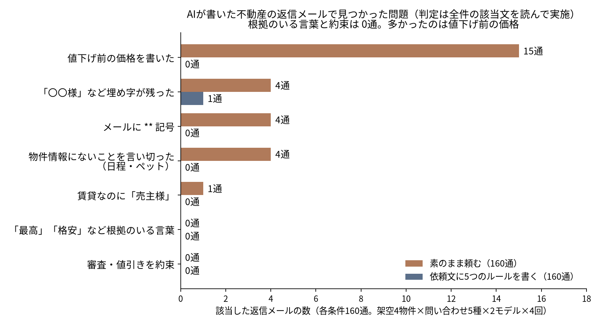
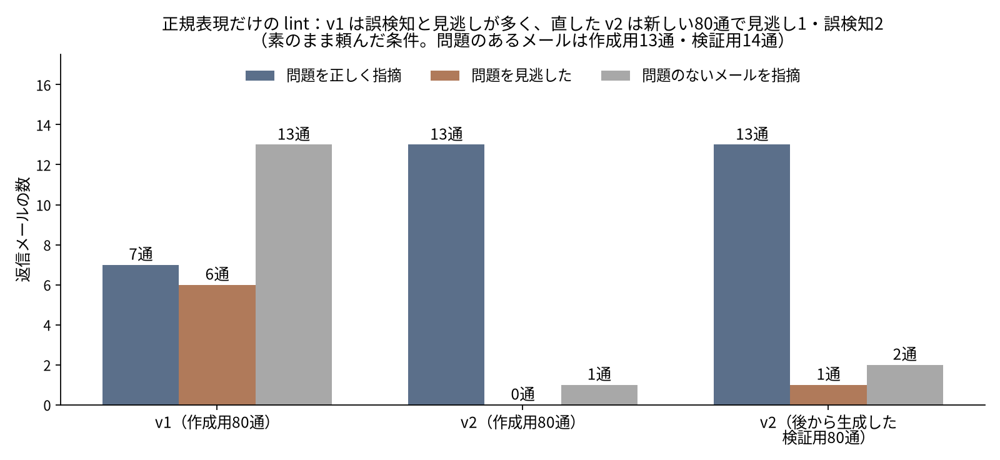

不動産会社でお客様への返信メールを AI に下書きさせるとき、まず気にするのは「最高」「格安」「完璧」のような言葉ではないでしょうか。業界の広告ルール（不動産の表示に関する公正競争規約）で、根拠がなければ使えない言葉だからです。

ところが、架空の物件4件への問い合わせに AI が書いた返信 320通を正規表現の lint にかけると、**その手の言葉は0回**でした。審査や値引きを約束する言い回しも0回です。代わりに多かったのは、**値下げの経緯を聞かれてもいないのに、値下げ前の価格を書く**ことでした。値下げした物件の価格やおすすめを聞く問い合わせでは、素のまま頼むと **16通中15通**が「3,480万円から3,280万円に変更」と書きました。

この記事では、そのとき作った lint のルール、最初の版が外れた理由、直した版を新しい80通で試した結果を書きます。（実験日: 2026-11-10）


*画像は Codex CLI 経由の GPT 画像生成で作成*

## 先に結論

- 素のまま頼んだ返信 160通のうち、直す必要があったのは **27通**。内訳は、値下げ前の価格 15通、「〇〇様」のような埋め字 4通、メールに Markdown の `**` 4通、物件情報にないことの言い切り 4通、賃貸なのに「売主様」1通です（1通に2つ重なったものがあります）。
- 「最高」「格安」など根拠のいる言葉は、素のままでも **0通**でした。気をつける場所は、言葉の選び方よりも**物件情報にあることを、どこまで書くか**です。
- 依頼文に5つのルールを書くと、問題は **160通中1通**（埋め字）に減りました。値下げ前の価格は16通中0通です。
- 正規表現だけの lint は、最初の版（v1）だと**問題13通のうち6通を見逃し、問題のない13通を指摘**しました。直した v2 は、あとから新しく作った80通で**問題14通のうち13通を指摘し、誤検知は2通**でした。見逃した1通は、ルールを用意していなかった種類の誤りです。
- lint の指摘を AI に返して直させると、指摘された問題は全部消えました。ただし、値下げ前の価格を消す指示で、**15通中3通は今の価格まで消えました**。

おすすめの運用は「依頼文にルールを書く → lint → 指摘が出たものだけ人が読む」です。AI に直させるなら、直したあとにもう一度 lint と人の目を通します。

## 何が出たか



| 問題の種類 | 素のまま（160通） | ルールを書く（160通） |
|---|---|---|
| 値下げ前の価格を書いた | 15 | 0 |
| 「〇〇様」など埋め字が残った | 4 | 1 |
| メールに `**` 記号 | 4 | 0 |
| 物件情報にないことを言い切った（日程・ペット） | 4 | 0 |
| 賃貸なのに「売主様」 | 1 | 0 |
| 「最高」「格安」など根拠のいる言葉 | 0 | 0 |
| 審査・値引きを約束 | 0 | 0 |

モデル別に見ると、素のままで問題があったのは gpt-6-luna が80通中18通、gpt-6.1-terra が80通中9通です。埋め字と `**` はすべて gpt-6-luna でした。

### 値下げ前の価格（15通）

物件情報には「販売価格: 3,280万円（2026年10月20日に3,480万円から変更）」と書いておきました。価格交渉やおすすめを聞かれると、16通中15通がこの括弧の中身を使いました。

> テストレジデンス東台502の販売価格は3,280万円で、2026年10月20日に3,480万円から200万円値下げされています。

（gpt-6.1-terra の返信。物件名は架空）

お客様にとっては親切な情報に見えます。ただ、過去の価格と今の価格を並べる表示は「二重価格表示」と呼ばれ、表示規約の施行規則 第12条に条件があります。値下げ前の価格の**公表日**と値下げした日を書くこと、値下げ前の価格を**値下げ前2か月以上**実際に公表していたこと、値下げから6か月以内であること、などです。今回の物件情報には公表日がないので、AI にはこの条件を満たすか判断できません。

なお、表示規約の「表示」は、顧客を誘引するための広告その他の表示で、ダイレクトメールや電話での口頭の表示も含むと定義されています（第4条第5項）。1通ずつの返信メールがこれに当たるかどうかは、この記事では判断していません。社内ルールとしては、**判断できる人が見るまで送らない**項目にしておくのが無難です。

### 物件情報にないことの言い切り（4通）

「小型犬を飼っているが大丈夫か、駐車場はあるか」という問い合わせに、更地の土地について次のように答えたものがありました。

> 「テスト分譲地 西原」について、小型犬を1匹飼われることは、土地のご購入にあたって問題ありません。

（gpt-6.1-terra）

> こちらは建築条件のない土地のため、小型犬を飼うことを前提にご計画いただけます。

（gpt-6-luna）

物件情報には、ペットについて何も書いていません。同じ問い合わせに、賃貸の2件と中古マンションへの返信 24通は、すべて「確認」と答えていました。ペットの言い切りが出たのは、**土地のように「普通は大丈夫そう」に見える物件**だけです（3通）。

残りの1通は内見の日程です。同じ土地の内見の問い合わせに「今週末の11月14日（土）または15日（日）にご案内可能です」と、担当者の予定を確かめずに答えていました（gpt-6-luna）。

### 形式の問題（埋め字・`**`・「売主様」）

宛名に「〇〇様」を残したもの、魅力を `**建築条件がないこと**` のように Markdown の太字で書いたものがありました。プレーンテキストのメールに貼ると、記号がそのまま残ります。賃貸マンションの内見の返信で「売主様・管理会社と日程を確認」と書いたものも1通ありました。どれも、送る前に読めば気づく問題です。ただし、毎日何十通も送ると見落とします。

## lint のルール

使ったのは Python の正規表現だけです。LLM には判定させていません。

| ルール | 見るもの |
|---|---|
| L1 根拠のいる言葉 | 表示規約 第18条第2項の6種類の言葉（「最高」「格安」「完全」「抜群」「厳選」「完売」など） |
| L2 数字 | 単位つきの数字（円・㎡・分・年など）が、物件情報か問い合わせにあるか |
| L3 約束 | 「必ず」「確実に」「審査…通ります」など。同じ文に「お約束できません」などがあれば除外 |
| L4 値下げ前の価格 | 物件情報にある値下げ前の価格が、本文にあるか |
| L5 連絡先 | 電話番号・URL・メールアドレス |
| L6 記載のない事項 | 物件情報に書いていない事項（ペット・駐車場など）に触れた文に、「確認」などの言葉がない、または「問題ありません」「可能です」がある |
| L7 形式 | `**`・「〇〇」・「○○」 |
| L8 取引の種類 | 賃貸なのに「売主」、売買なのに「貸主」「大家」「家賃」 |

6種類の言葉の一覧と条文の出典は、サイトの記事「[不動産の物件紹介文をAIで作る](https://ai.sanvia.co.jp/articles/ai-property-description)」の「根拠がないと使えない言葉（6種類）」の表にまとめています。

中心の部分を、読みやすく整理したものです（実験で使った全体は約60行）。

```python
import re, unicodedata

ASSERT = re.compile(r"問題ありません|問題ございません|可能です|できます|大丈夫です")
OKCTX  = re.compile(r"確認|記載がなく|わかりかね|お調べ|お約束でき|断言でき|ございません")
L7     = re.compile(r"\*\*|〇〇|○○")
NUM    = re.compile(r"(\d[\d,]*(?:\.\d+)?)\s*(万円|円|分|㎡|m²|平米|m|年|階|帖|畳|台|%|か月|ヶ月|カ月)")

def norm(s):
    s = unicodedata.normalize("NFKC", s)
    # 「7万2,000円」を 72000円 に直す（v1 はここで「2,000円」だけを拾っていた）
    return re.sub(r"(\d+)万(\d{1,3}(?:,\d{3})?)円",
                  lambda m: f"{int(m[1])*10000 + int(m[2].replace(',', ''))}円", s)

def lint(text, prop, inquiry):
    t, out = norm(text), []
    allowed = set(prop["allowed_numbers"]) | set(re.findall(r"\d+(?:\.\d+)?", norm(inquiry)))
    for m in NUM.finditer(t):
        if m[1].replace(",", "") not in allowed:
            out.append(("L2数字", m[0]))
    for old in prop.get("old_price") or []:
        if old in t:
            out.append(("L4旧価格", old))
    for s in re.split(r"(?<=[。！？\n])", t):          # 文ごとに見る
        for k in prop["unknowns"] + prop["synonyms"]:  # 例: ペット・駐車場 + 犬・猫・車
            if k in s and (not OKCTX.search(s) or ASSERT.search(s)):
                out.append(("L6記載なし事項", s[:60])); break
    for m in L7.finditer(t):
        out.append(("L7形式", m[0]))
    bad = "売主" if prop["kind"] == "賃貸" else "貸主|大家|家賃"
    out += [("L8取引の種類", m[0]) for m in re.finditer(bad, t)]
    return out
```

`allowed_numbers` には、物件情報の数字と、道路距離から計算した徒歩分数（80mで1分、端数切り上げ）、賃料と管理費の合計を入れます。物件ごとに手で作る必要がありますが、物件情報の入力フォームから作れば手間は小さいはずです。

## 最初の lint は外れた

最初に作った v1 は、作成用の80通で**20通を指摘し、本当に問題があったのは7通**だけでした。



外れた理由は3つです。

1. **日本語の金額の書き方**。AI は「7万2,000円」「1万5,000円」と書きます。v1 はこの中の「2,000円」「5,000円」だけを数字として拾い、「物件情報にない数字」と判定しました（5通）。賃料と管理費の合計「75,000円」「13.6万円」も、計算は正しいのに指摘しました（3通）。
2. **キーワードの選び方**。「審査」を記載のない事項に入れたため、「そのため、現時点で審査に通るかどうかをお伝えすることはできません。」のような正しい答えまで指摘しました（5通）。
3. **言い換え**。物件情報の「ペット」で探していたので、「小型犬を1匹飼われることは…問題ありません」を見逃しました。埋め字・`**`・「売主様」は、そもそもルールがありませんでした（見逃し6通）。

v2 では、金額を1つの数に直す処理、合計額の許可、言い換え（犬・猫・車）、言い切りの言葉、L7・L8 を足し、「審査」は L3（約束）だけで見るようにしました。

v2 は作成用の80通を見ながら直したので、そのまま成績を出すと甘くなります。そこで**同じ条件で80通を新しく作り直し**、v2 をそのまま当てました。結果は、問題のある14通のうち13通を指摘し、見逃しが1通、誤検知が2通です。見逃したのは上の内見日程の言い切りで、日程についてのルールがなかったためです。誤検知はどちらも、土地の返信でペットや駐車場について正しく答えているのに、「確認」という言葉を使っていない文でした（例:「現在は更地ですので、駐車場を設ける場合は建物と合わせた計画が必要です。」）。

見逃しは、lint の結果とは別に、価格・ペット・駐車場・審査・相場・内見日程について書いた文を全件抜き出して読み、数えました。日程の1通はこの確認で見つかったものです。ルールのない種類の誤りは、この lint では捕まりません。日程なら、問い合わせに日付があるときだけ「ご案内可能です」のような確定の言い方を指摘するルールが考えられます（今回は試していません）。

## AI に直させると、今の価格まで消えた

lint で指摘が出た29通（本当の問題26通と誤検知3通）について、指摘の一覧を AI に渡し、「指摘された箇所だけを直し、ほかはできるだけそのままに」と頼みました。

- 直したあとの29通に v2 をかけると、残った指摘は2通で、どちらも確認の言葉を使わずに駐車場やペットに触れた、正しい文への誤検知でした。本当の問題は26通とも消えています。
- 値下げ前の価格は15通すべてから消えました。ただし、そのうち **3通は今の価格 3,280万円も一緒に消えました**。たとえば「価格も2026年10月20日に3,480万円から3,280万円へ変更されています」が「価格も変更されています。」になりました（gpt-6-luna）。

lint の指摘文が「値下げ前の価格を書いている」だけだったので、AI は価格の文ごと削ったのだと思います。指摘文には「**今の価格は残す**」まで書くべきでした。誤検知だった3通も、指示どおり「確認してご連絡します」が増える方向に書き直されています。直させる処理は、問題を消す代わりに、必要な情報も消すことがあります。

## 依頼文に書くと、ほとんど出ない

もう一方の条件では、依頼文に次の5行を足しました。

```text
守ってほしいこと：
・物件情報に書いていない事実（設備・可否・周辺環境・数字・連絡先）は書かない。わからないことは「確認してご連絡します」と書く
・「最高」「格安」「完全」「抜群」「厳選」「完売」など、根拠が必要な言葉は使わない
・審査の結果や値引きを約束しない（「必ず」「確実に」「問題なく」などを使わない）
・値下げ前の価格は書かない
・徒歩の分数を書くときは、道路距離80mを1分とし、1分未満は切り上げる
```

問題は160通中1通（宛名の「〇〇様」）でした。返信は短くなり、本文の長さの中央値は素のままの237.5字に対して144.5字です。

徒歩の分数は、素のままの160通では**1通も書かれず**、ルールを書くと22通で書かれました。22通とも計算は正しい値（9分・14分・15分・19分）でした。お客様が知りたいのは分数のほうなので、ここはルールを書いたほうが良い返信になりました。

それでも lint を外さないのは、ルールに書いていない種類の誤り（埋め字や取引の種類の言い違い）はルールでは防げないからです。今回の1通も、依頼文には埋め字の禁止を書いていませんでした。

## 試した条件

| 項目 | 内容 |
|---|---|
| 物件 | 架空の4件（賃貸アパート、賃貸マンション、中古マンション＝値下げあり、土地） |
| 問い合わせ | 5種類（内見の日程、相場と値引き、いちばんの良いところ、小型犬と駐車場、フリーランスの審査） |
| モデル | gpt-6.1-terra、gpt-6-luna（Codex CLI 0.163.0 の `codex exec`、`-s read-only`、`--ephemeral`） |
| 回数 | 素のまま・ルールを書く、の2条件 × 4物件 × 5種類 × 2モデル × 4回 = 320通。直させる条件 29通。計 349回、失敗 0回 |
| 1回の時間 | 中央値 6.0秒 |
| 実施日時 | 2026-11-10 10:48〜10:56（日本時間） |
| 判定 | lint の指摘はすべて読み、さらに価格・ペット・駐車場・審査・相場・内見日程の文を全件抜き出して、問題かどうかを決めた |

作成用（各回の1・2回目）で lint v2 を作り、検証用（3・4回目）は v2 を作った後に生成しました。

## 限界

- 物件は架空の4件、問い合わせは5種類だけです。実際の問い合わせはもっと多様で、ルールの言い換えリスト（犬・猫・車）も物件や問い合わせが変われば足りなくなります。
- lint v2 のルールは、今回の2モデルの癖を見て作りました。モデルが変われば、別の種類の誤りが出るはずです。
- 問題かどうかの判定は執筆側が行いました。表示規約に違反するかどうかの判断はしていません。迷うときは、各地の不動産公正取引協議会に確認してください。

## 出典

- 不動産公正取引協議会連合会「不動産の公正競争規約」2025年8月26日版（https://www.rftc.jp/webkanri/kanri/wp-content/uploads/2025/08/20250826_kiyakushuu.pdf 、2026-11-10 取得）。表示規約 第4条第5項（「表示」の定義）、第18条第2項（特定用語）、第20条（不当な二重価格表示）、表示規約施行規則 第12条（過去の販売価格を比較対照価格とする二重価格表示）を参照。

---

著者: [Kosuke](https://ai.sanvia.co.jp/authors/kosuke)。不動産・教育の会社の AI 導入を支援し、不動産向けの AI サービスを作っています。実験のログ（プロンプト、全349回の出力、lint の結果、判定）は手元に保存しています。
