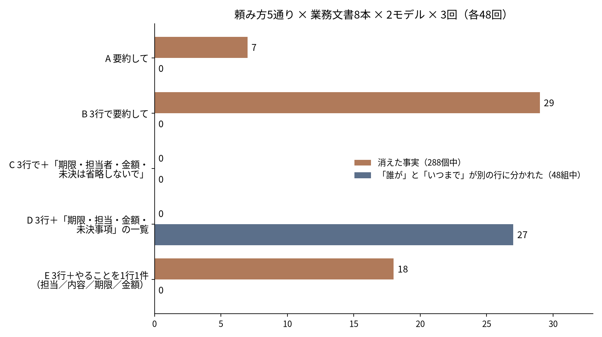
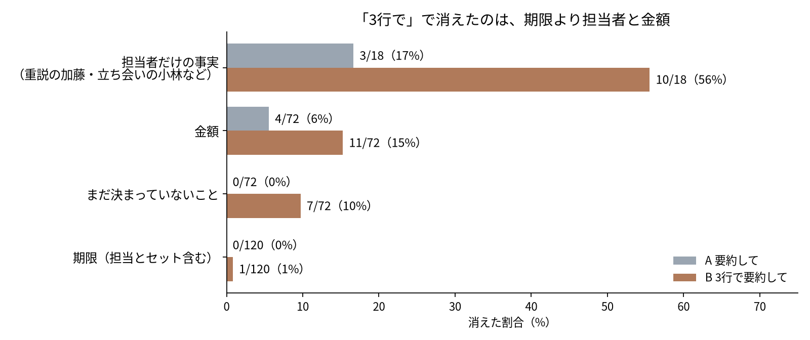

会議メモや報告メールを AI に「3行で要約して」と頼むと、読みやすい3行が返ってきます。ただ、その3行から**「誰がやるのか」が静かに消えている**ことがあります。期限の日付は残っているので、ぱっと見では気づきにくい抜け方です。

架空の業務文書8本（賃貸仲介の会議、管理会社の修繕報告、理事会の文字起こしなど）を、頼み方5通り・2モデル・各3回、合計 **240回** 要約させて、残るべき事実48個が残ったかを数えました。「3行で要約して」だけだと、288個の事実のうち **29個（10%）が消え**、担当者だけの事実は **18個中10個** が消えました。同じ3行のまま「期限・担当者・金額・まだ決まっていないことは省略しないでください」と一言足すと、**消えたのは0個**です。

もう1つ意外だったのは、抜けを防ごうとして「期限・担当・金額・未決事項の一覧もつけて」と頼むと、**事実は全部残るのに「誰が」と「いつまでに」が別々の段に分かれる**ことでした。48組中27組がそうなりました。（実験日: 2026-11-17）


*画像は Codex CLI 経由の GPT 画像生成で作成*

## 先に結論

- **「3行で」は、期限より担当者と金額を落とします。** 期限は120個中1個しか消えませんでしたが、担当者だけの事実（「重要事項説明は加藤」「立ち会いは小林」）は18個中10個、金額は72個中11個が消えました。
- **一言足せば3行のままで足ります。** 「期限・担当者・金額・まだ決まっていないことは省略しないでください」で、消えた事実は29個→0個。行数の中央値は3行のまま、平均の字数は162字→206字でした。
- **「一覧もつけて」は逆効果になることがあります。** 期限の段と担当の段に分けて書くので、「誰がいつまでに」の組が48組中27組で切れました。平均488字と、3行の要約の3倍あります。
- **「1行に1件、担当／内容／期限／金額」の形にすると組は切れません**（48組中0組）。ただし「やること」に入らない事実（休業中の緊急連絡先、コンサル費用の相場）は落ちやすく、288個中18個が消えました。
- **雑談も要約に入ります。** 会議の最後の「昼のお弁当、別の店にしませんか（笑）」は、雑談を除けと書かなかった4通りで24回中15回、要約か未決事項に入りました。

おすすめは、**ふだんの3行要約には一言足す（C）**、**担当と期限の表がほしいときは1行1件の形（E）にして、やることに入らない数字と連絡先は自分で拾う**です。

## この記事でいう「消えた」とは

**「消えた」とは、原文にある事実（期限・担当・金額・まだ決まっていないこと）を、要約のどの1行を読んでも組み立てられない状態**のことです。

たとえば「田中が11月21日までにチラシを入稿」は、「田中」と「11月21日」が同じ1行に出ていれば残った、と数えます。「田中」と「11月21日」がどちらも出ていても、別の行（別の段）に分かれていれば「組が切れた」と数え、「消えた」とは分けて集計しました。判定はスクリプトで行い、そのあと「消えた」と出たものを1件ずつ目で読み直しました（後述）。

## 結果



| 頼み方（各48回） | 消えた事実（288個中） | 「誰が」と「いつまで」が切れた組（48組中） | 平均の字数 | 行数の中央値 | 問題のあった回 |
|---|---|---|---|---|---|
| A 要約してください | 7 | 0 | 213字 | 4行 | 7回 |
| B 3行で要約してください | **29** | 0 | 162字 | 3行 | 24回 |
| C 3行で＋「期限・担当者・金額・まだ決まっていないことは省略しないで」 | **0** | 0 | 206字 | 3行 | **0回** |
| D 3行＋「期限・担当・金額・未決事項」の一覧 | 0 | **27** | 488字 | 19行 | 15回 |
| E 3行＋「やること」を1行1件（担当／内容／期限／金額） | 18 | 0 | 375字 | 11行 | 17回 |

「問題のあった回」は、消えた事実か切れた組が1つでもあった回の数です。モデル別では、B は gpt-6.1-terra 14個・gpt-6-luna 15個とほぼ同じで、D の切れた組は gpt-6.1-terra 19組・gpt-6-luna 8組でした。

### 「3行で」で何が消えたか



B（3行で）で消えた29個の内訳です。

| 消えた事実 | 6回中 |
|---|---|
| 売買の報告で「重要事項説明は宅建士の加藤」 | 6 |
| 理事会で「コンサル費用は最安で年間55万円」 | 6 |
| 苦情の報告で「305号室の家賃は月7万2千円」 | 5 |
| 修繕報告で「立ち会いは担当の小林」 | 4 |
| 苦情の報告で「405号室にはまだ連絡していない」 | 4 |
| リフォームで「上位グレードは18万円追加、オーナーの判断待ち」 | 2 |
| 総務の連絡で「忘年会の会場は未定」 | 1 |
| 理事会で「原が11月23日に張り紙」 | 1 |

傾向ははっきりしていて、**日付とセットになっている担当（「佐藤が12月5日までに」）は残り、日付のない担当（「重説は加藤」「立ち会いは小林」）が消えます**。3行に収めるとき、AI は「いつ・何が起きるか」を優先して、日付のない人名を削っているように見えます。期限の抜けが1個だけだったのはそのためです。

ところが現場で困るのは、まさにその「日付のない担当」です。重説を誰がやるか、立ち会いに誰が行くかは、要約を読んだ人が次に電話する相手だからです。

### 「一覧もつけて」で起きたこと

D は「一覧には、原文にある日付・担当者・金額・まだ決まっていないことを漏れなく書いてください」と頼んだので、事実そのものは全部残りました。ただ、出てきた一覧はこういう形です（gpt-6-luna、理事会の文字起こし。抜粋）。

```text
- **期限**
  - 11月23日：放置自転車に張り紙。
  - 12月6日まで：比較表を理事全員に送付。会場の空きも調査。
  - 12月の理事会：コンサル会社を1社に決定。
- **担当**
  - 比較表の作成・送付、会場の空きの調査：坂本さん。
  - 張り紙：原さん。
```

頼んだ見出しの「期限・担当・金額・未決事項」を、そのまま**段の分け方**として使っています。坂本さんの期限を知るには、担当の段で作業名を見て、期限の段で同じ作業を探す必要があります。項目が5つ程度なら読めますが、会議が長くなると読み違いのもとです。48回中45回は `**` の太字つきで、メールやチャットにそのまま貼ると記号が残ります。

### 1行1件にしたら

E は「担当：〇〇／内容：〇〇／期限：〇〇／金額：〇〇」の形を1行に1件で指定しました。同じ会議（gpt-6-luna、店舗の会議。抜粋）はこうなります。

```text
### やること
担当：田中／内容：来店予約キャンペーンのチラシを入稿／期限：11月21日／金額：記載なし
担当：山本／内容：臨時スタッフの求人広告を手配（掲載開始）／期限：11月25日／金額：月8万円まで
担当：佐藤／内容：鍵をなくしたお客様への対応手順書を改訂／期限：12月5日／金額：記載なし
```

組が切れたのは48組中0組です。代わりに、**「やること」に当てはまらない事実が落ちました**。休業中の緊急連絡先「管理部の松本」は6回中6回、理事会の「コンサル費用は最安で年間55万円」は6回中4回消えました。どちらも、誰かの作業ではない情報です。形を決めると、その形に入らないものは捨てられます。

### 雑談が入る

店舗の会議の最後に「昼のお弁当、来週から別の店にしませんか（笑）」「それはまた今度」というやり取りを入れておきました。雑談を除くよう書かなかった A〜D では、24回中15回、これが要約か一覧に入りました（A 3回・B 3回・C 4回・D 5回、各6回中）。D では「未決事項」の段に「昼の弁当を別の店に変更するかどうか。」と、まじめな未決事項と同じ扱いで並んだ回もあります。E（「冗談や雑談は入れないでください」と書いた）は6回中0回でした。

## よくある失敗（アンチパターン）

どれも今回の240回で実際に出たものです。

1. **「3行で」とだけ頼む。** 日付のない担当者と金額から消えます（担当 18個中10個、金額 72個中11個）。期限が残っているので、抜けに気づきにくいのが厄介です。
2. **抜けを防ごうとして、項目名の一覧を頼む。** 「期限・担当・金額・未決事項」は、AI にとって段の見出しになります。「誰がいつまでに」が48組中27組で切れました。
3. **形を決めたら全部入ると思う。** 1行1件の形は組を守りますが、形に入らない緊急連絡先や相場の金額は落ちます（288個中18個）。
4. **雑談の扱いを書かない。** 雑談が未決事項として並びます（24回中15回）。
5. **太字を気にしない。** D は48回中45回、A でも48回中28回 `**` が入りました。チャットに貼るなら「記号は使わない」と書きます（C・B は今回0回でした）。

## そのまま使える依頼文

ふだんの3行要約（C。消えた事実 0/288、平均206字）:

```text
次の文章を3行で要約してください。期限・担当者・金額・まだ決まっていないことは省略しないでください。

---
（ここに会議メモや報告メール）
```

担当と期限の一覧がほしいとき（E。組が切れた 0/48。やることに入らない数字・連絡先は落ちやすいので、そこだけ自分で確かめる）:

```text
次の文章を、3行の要約と、その下の「やること」「まだ決まっていないこと」に分けてまとめてください。「やること」は1行に1件、「担当：〇〇／内容：〇〇／期限：〇〇／金額：〇〇」の形で書き、原文にない項目は「記載なし」と書いてください。冗談や雑談は入れないでください。

---
（ここに会議メモや報告メール）
```

C と E を組み合わせた依頼文（「やること」の外の数字・連絡先も残せと書く版）は、今回は試していません。

## チェックリスト

要約を人に回す前に、原文と見比べて確かめること。

- [ ] 日付のない担当者（立ち会い・説明する人・連絡先）が残っているか
- [ ] 金額が残っているか。特に「やること」に結びつかない金額（家賃・相場・費用の目安）
- [ ] 「まだ連絡していない」「まだ決まっていない」が、決まったことのように書かれていないか
- [ ] 担当と期限が同じ行にあるか（段が分かれていたら1行1件に直させる）
- [ ] 雑談が未決事項に入っていないか
- [ ] 貼り先で `**` や `#` が記号のまま出ないか

## 実験の設定

- 日時: 2026-11-17 10:34〜10:42（JST）に240回。`codex exec`（codex-cli 0.163.0）、モデルは gpt-6.1-terra と gpt-6-luna。終了コードはすべて0。1回の所要時間の中央値は B 5.4秒〜D 10.4秒。
- 文書: 8本、すべて架空（会社・人物・物件・金額）。賃貸仲介店舗の週次会議（文字起こし）、管理会社からオーナーへの修繕報告メール、入居者の騒音苦情の社内報告、売買仲介の進捗報告、総務の年末の連絡、リフォームの打合せメモ、更新契約の対応報告、管理組合の理事会（文字起こし）。1本300〜470字。
- 事実: 1本につき6個、計48個（期限20・金額12・まだ決まっていないこと12・担当3・その他1）。期限のうち8個は「担当＋日付」の組。
- 条件: 頼み方5通り × 文書8本 × 2モデル × 3回 = 240回（各条件48回）。依頼文の末尾には、全条件に「（ファイルやウェブは見ずに、この文章だけをもとに答えてください）」をつけました。
- 実行は空の作業ディレクトリで `-s read-only`・`--ephemeral`・`--ignore-user-config`。秘密情報の環境変数は外しました。

ディレクトリ構成:

```text
zenn-1117/
├── docs.py         # 文書8本と、残るべき事実48個（判定用の語の候補つき）
├── run.py          # 5条件 × 8本 × 2モデル × 3回を codex exec で実行
├── prompts.json    # 5条件の依頼文
├── runs/           # 1回ごとの prompt / jsonl / out.txt / meta.json
├── score.py        # 事実ごとに「同じ1行に要素がそろうか」を判定 → score.json
├── overrides.json  # 目で読み直して判定を直した5件と理由
├── summarize.py    # 条件ごとの集計 → summary.json
└── make_figs.py    # 図2枚
```

実行の中心（`run.py` から抜粋）:

```python
cmd = ["codex", "exec", "--json", "--ephemeral", "--skip-git-repo-check",
       "--ignore-user-config", "-s", "read-only", "-m", model,
       "-o", base + ".out.txt", "-"]
subprocess.run(cmd, input=prompt.encode(), stdout=o, stderr=e,
               cwd=f"{H}/work", env=env, timeout=300)
```

判定（`score.py` から抜粋）。事実ごとに「要素のグループ」を持ち、全グループの語のどれかが**同じ1行に**出れば残ったとします。全角半角とカンマ、`**` はそろえてから比べます。

```python
# 例: {"id":"d1f1","type":"期限","label":"田中がチラシ入稿 11月21日",
#      "any":[["田中"],["11月21日","11/21"]]}
ok = any(all(any(norm(t) in line for t in grp) for grp in f["any"])
         for line in lines)
```

### 目で読み直したところ

自動判定で「消えた」となったものを1件ずつ読み、次の5件は残っていると直しました（`overrides.json`）。「岡田様が20日までに色見本」（月を省略、1件）、「個別連絡の担当（課長か中村さんか）は未決定」（1件）、一覧の未決事項の行に「忘年会の会場」とだけあるもの（3件）。逆に、「405号室へ個別連絡する案」とだけ書いて「まだ連絡していない」に触れないもの、小林さんを「給湯器を交換」の担当にしたもの（原文は立ち会い）は、消えたのままにしました。

## 限界

- 文書は8本、1本300〜470字の短いものです。1時間の会議の文字起こしでは、抜け方が変わるはずです。
- 判定は「同じ1行」を単位にしています。1行が長い要約ほど、組が残ったと数えられやすい判定です。
- モデルは2つ、各条件48回です。C の0/288は、この8本と2モデルでの結果です。
- E は D と比べて「1行1件の形」「記載なしと書く」「雑談を入れない」の3点が違います。どれが効いたかは分けていません。

営業報告と会議の文字起こしで別に24回試した結果と、要約の依頼文の例は、サイトの記事「[ChatGPTで要約する方法](https://ai.sanvia.co.jp/articles/chatgpt-summary)」にまとめています。

## 参考資料

- Codex CLI（OpenAI）: https://developers.openai.com/codex/cli
- 非対話モード `codex exec`（OpenAI）: https://developers.openai.com/codex/noninteractive
- Codex のモデル（OpenAI）: https://developers.openai.com/codex/models
