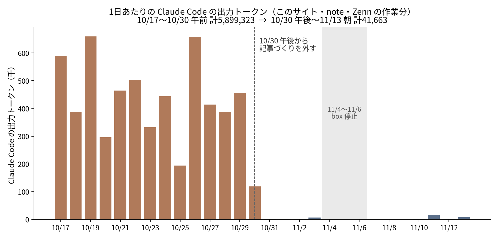
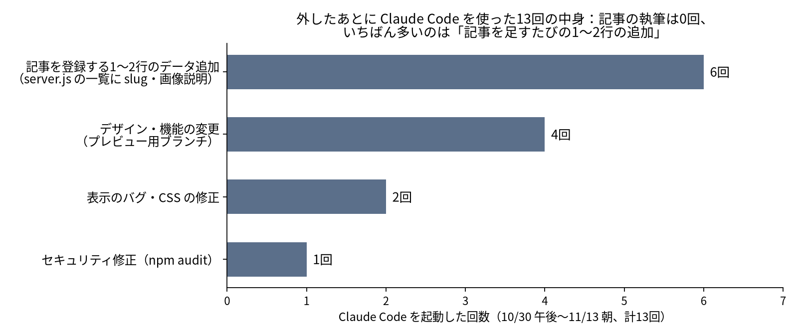

Claude Code に何でも任せていると、利用枠の減り方が読めなくなります。私の場合、毎日動く AI のルーティンが、サイトのコード修正だけでなく、記事の調査・執筆・図づくり・git 操作まで Claude Code に頼んでいました。

そこで 2026年10月30日の午後から、**Claude Code に頼むのは「サイトのコード・デザインの変更」と「セキュリティ修正」だけ**にして、書く仕事はほかのエージェントに移しました。ログを数えると、変更前の約13日で **5,899,323** あった Claude Code の出力トークンは、変更後の約14日で **41,663**（約140分の1）。起動回数は **145回 → 13回** です。

この記事では、どう分けたか、どう数えたか（ログの数え方には1つ落とし穴があります）、残った13回が何だったかを書きます。（集計日: 2026-11-13）


*画像は Codex CLI 経由の GPT 画像生成で作成*

## 先に結論

- **人間が見るのは、Claude Code が作ったデザイン変更のプレビューだけ**です。デザイン変更はプレビュー用ブランチで作り、承認してから本番に出します。記事はルーティンが自動の検査（リンク・画像・構造化データ・表示速度など）を通して公開します。
- 変更前（10/17 12:25〜10/30 12:35）と変更後（10/30 16:56〜11/13 09:36）で、Claude Code は **セッション 145 → 13、応答 7,642 → 114、出力トークン 5,899,323 → 41,663** になりました。
- 変更後の13回に**記事の執筆は0回**。いちばん多かったのは、記事を1本足すたびに `server.js` の一覧へ1〜2行を足す作業（**6回**）でした。どれも応答3〜5回、出力447〜1,467トークンで終わっています。
- サイトに足した記事の数は、変更前 13日で32本、変更後は box が止まっていた3日を除く11日で25本（1日 2.5本 → 2.3本）。
- **これは「AI の作業量が減った」話ではありません**。調査や執筆は別のエージェントと Codex に移っただけで、そちらの使用量やお金はこの記事では比べていません。

## 何をどう分けたか

このサイト（ai.sanvia.co.jp）と note・Zenn は、毎日〜週1回動く11本のルーティンで回しています。日次のサイト改善、平日2回の速報、サイト記事（週3回）、不動産向けの入門記事（毎日）、note（週2回）、Zenn（週2回）、週次の効果測定、毎朝のセキュリティチェック、ハーネスの見直し、人気記事の傾向分析、有名サイトの分析です。

10月30日までは、ルーティンの多くが Claude Code を起動して「調査から公開まで全部」を頼んでいて、依頼文の冒頭はたとえば次のような形でした。

> あなたはnote記事1本分の「公開可能パッケージ」の調査・検証・執筆・作図・ファイル作成をすべて担当します。

10月30日の午後から、境界を**ファイルの場所**で決めました。

| 仕事 | 担当 |
|---|---|
| `server.js`、`api/`、JS・CSS、テンプレート、`scripts/` の変更 | Claude Code |
| セキュリティ修正（毎朝のチェックで見つかったもの） | Claude Code |
| 調査、Codex での実験、本文、図、画像、公開前の検査、git、IndexNow、ログ | ルーティンを回しているエージェントが自分で行う（画像は Codex CLI の画像生成） |
| note・Zenn の記事 | Claude Code は使わない |

Claude Code への依頼は小さく閉じた形にしました。記事の登録やプレビューの依頼では、コミットや push は Claude Code にさせず、呼んだ側がします（セキュリティ修正だけは、修正から push・本番確認まで Claude Code に頼んでいます）。

> In /workspace/ai-michishirube/server.js, find the line 'const RE_SLUGS = new Set([...]);' and append the slug '…' as the last element of that array …

## どう数えたか

Claude Code は、セッションごとの記録を `~/.claude/projects/<作業ディレクトリ>/<セッションID>.jsonl` に残します。サブエージェントの記録は、その下のフォルダに別ファイルで入ります。この JSONL の `type: "assistant"` の行にある `message.usage` を足しました。

### 落とし穴：同じ応答の usage が何行も出てくる

最初に素直に全行を足したところ、変更前の出力トークンは **14,676,098** になりました。ところが記録を見ると、1つの応答の中身（文章・ツール呼び出しなど）が別々の行に分かれて保存され、**どの行にも同じ `usage` が付いています**。`message.id` で重複を除くと **5,854,348**（サブエージェント分を除く）で、素直に足すと約2.5倍に数えていました。

```python
import json, glob, os

def session_usage(path):
    seen, out, cache_read, n = set(), 0, 0, 0
    for line in open(path, errors="ignore"):
        try:
            d = json.loads(line)
        except json.JSONDecodeError:
            continue
        m = d.get("message") or {}
        if d.get("type") != "assistant" or not isinstance(m, dict):
            continue
        mid = m.get("id") or d.get("requestId") or d.get("uuid")
        if mid in seen:          # 同じ応答の2行目以降は数えない
            continue
        seen.add(mid)
        u = m.get("usage") or {}
        out += u.get("output_tokens", 0) or 0
        cache_read += u.get("cache_read_input_tokens", 0) or 0
        n += 1
    return n, out, cache_read

files = glob.glob(os.path.expanduser("~/.claude/projects/*/**/*.jsonl"), recursive=True)
```

### 対象にしたもの・しなかったもの

- 対象: 作業ディレクトリ（記録の `cwd`）がこのサイトのリポジトリ、その worktree、note・Zenn の作業フォルダのセッション。変更前の 145 セッション＋サブエージェント記録15本、変更後の13セッション。
- 対象外: 同じマシンで動いている別のボットのプロジェクト。モデル比較の実験で `claude -p` を**測定対象として**呼んだセッション（変更前51・変更後26）。これは作業ではなく実験の中身なので外しました。
- 区切り: 変更前の最後のセッションが 10/30 12:35、変更後の最初が 10/30 16:56 です。

## 結果

| | 変更前（10/17 12:25〜10/30 12:35） | 変更後（10/30 16:56〜11/13 09:36） |
|---|---:|---:|
| セッション数 | 145 | 13 |
| 応答の数（API の応答） | 7,642 | 114 |
| 出力トークン | 5,899,323 | 41,663 |
| キャッシュからの読み込みトークン | 927,905,694 | 3,594,211 |
| 1セッションの中央値（応答／出力トークン） | 41 ／ 31,299 | 5 ／ 1,506 |
| 出力がいちばん多かったセッション | 174,071 | 14,636 |

出力トークンは約141.6分の1、応答の数は約67分の1です。



変更前に出力が多かった上位5セッションのうち4つは、記事づくり（速報記事、note、記事の深掘り、Zenn）の依頼でした。note・Zenn の作業フォルダで動いたセッションは、変更前の 25 から変更後は 0 です。

## 残った13回は何だったか



| 種類 | 回数 | 応答の数 | 出力トークン |
|---|---:|---:|---:|
| 記事を登録する1〜2行のデータ追加（`server.js` の一覧に slug や画像説明を足す） | 6 | 各3〜5 | 447〜1,467 |
| デザイン・機能の変更（プレビュー用ブランチ。例: 実在画像への差し替え、テンプレートのダウンロード） | 4 | 5〜26 | 3,048〜14,636 |
| 表示のバグ・CSS の修正 | 2 | 6・6 | 1,647・1,506 |
| セキュリティ修正（npm audit の moderate 1件） | 1 | 20 | 4,986 |

ここから分かったことが2つあります。

### 1. 依頼を狭くすると、Claude Code は3応答で終わる

データ追加の6回は、どれも「このファイルのこの行に、これを足す。ほかは触らない。コミットしない」という依頼でした。応答は3〜5回、出力は 447〜1,467 トークンです。変更前の1セッションの中央値（41応答・31,299トークン）と比べると、**頼む範囲を決めるだけで1回の重さがまるで違います**。

### 2. 境界をファイルの場所で決めると、ただのデータ追加でも呼ぶことになる

13回のうち6回は、コードというより**記事の一覧データ**の追加でした。記事の slug や画像の説明文が `server.js` の中に書かれているため、「`server.js` は Claude Code」というルールに引っかかります。この一覧を JSON などのデータファイルに出せば、この6回は Claude Code を呼ばずに済むはずです（まだやっていません）。

## 記事の数は減ったか

サイトの `articles/` に新しく足された記事を git の履歴で数えました（初日 10/17 は既存記事の取り込み12本なので除外）。

| 期間 | 日数 | 足した記事 | 1日あたり |
|---|---:|---:|---:|
| 10/18〜10/30 | 13日 | 32本 | 2.5本 |
| 10/31〜11/13（11/4〜11/6 は除く） | 11日 | 25本 | 2.3本 |

11/4〜11/6 は、マシン（box）の問題でどのルーティンも動かなかった期間なので除きました。日付で区切っているので、10/30 の2本は変更前に入れています。わずかに減っていますが、この差が Claude Code を外したせいかどうかは、この数字だけでは分かりません。

## 確認できていないこと

- **全体のコストは比べていません**。調査・執筆・画像は別のエージェントと Codex に移っただけで、そちらの使用量は今回数えていません。言えるのは「Claude Code の利用枠をどこに使っているか」がはっきりした、ということだけです。
- **記事の質は比べていません**。公開前の自動検査は変更前後で同じものを通していますが、読まれ方の比較はまだです。
- 期間は約2週間ずつで、ルーティンの中身も少しずつ変えています。同じ条件で繰り返した実験ではありません。

## まとめ

Claude Code の利用枠を節約したいなら、まず**何に使っているかを JSONL から数える**のが早いです。そのとき `message.id` で重複を除かないと、2倍以上に多く見えることがあります。

私の場合は、書く仕事を外してコードの変更だけを頼むようにしたところ、2週間で出力トークンが約140分の1になりました。残った呼び出しの半分は「一覧に1行足す」だけだったので、次はその一覧をコードから出すつもりです。
