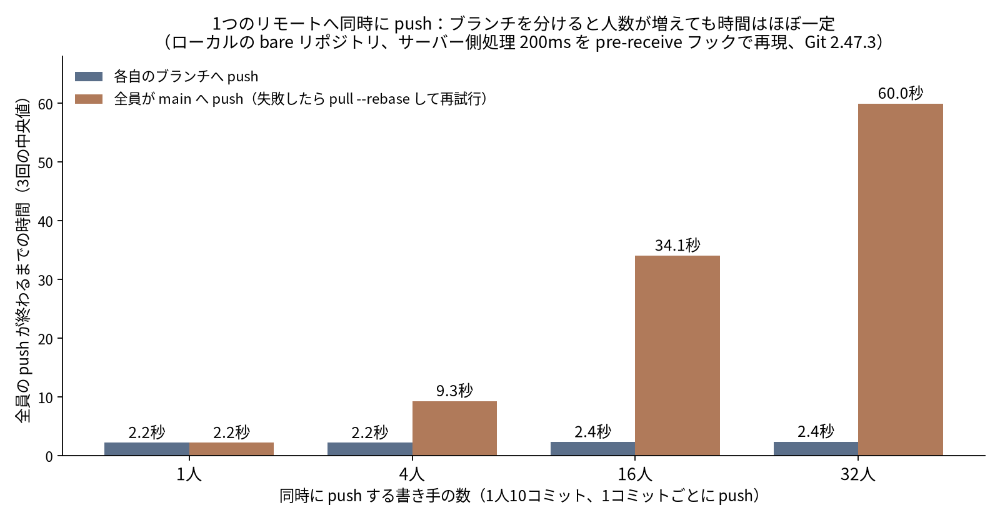
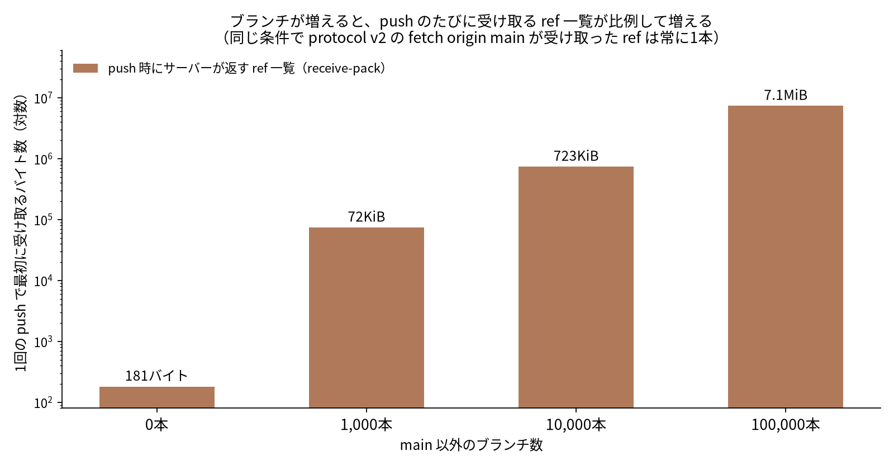

Codex や Claude Code のようなエージェントを何本も同時に走らせると、Git のところで詰まることがあります。push が rejected になり、`pull --rebase` をはさんで再試行し、そのうち誰かのコミットに別の作業が混ざっている。「リポジトリが大きいから」と考えがちですが、手元で測ってみると原因はもっとはっきりしていました。詰まるのは**同じブランチ（ref）に同時に書くとき**です。ブランチを分ければ、普通の Git サーバー1台でもほとんど詰まりません。

OpenAI は 2026年11月2日、社内のモノレポ用に作った Git の新しいバックエンド「Pando」の記事を出しました。そこにも「クライアントが衝突するのは、同じ ref に同時に push したときだけ」と書かれています（確認日: 2026-11-03）。この記事では Pando の要点をまとめ、それが手元の小さな環境でも同じように見えるかを3つの実験で確かめます。同時 push は合計 55,858 回、Codex CLI の同時実行は 40 回です。


*画像は Codex CLI（ChatGPT アカウント）経由の GPT 画像生成で作成*

## 先に結論

- 32人が同時に push しても、全員が**自分のブランチ**に push する限り rejected は0回でした。サーバー側に 200ms の処理を入れた条件では、終わるまでの時間は1人のとき 2.2秒、32人のとき 2.4秒です。
- 全員が **main** に push すると、32人の条件では1試行（320コミット）あたり平均 3,755 回 rejected され、終わるまでに 12.8秒かかりました。サーバー側の処理が 200ms あると 60.0秒です。ref の保存形式を reftable に変えても、ほとんど変わりませんでした。
- ブランチ数が効くのは push のときに受け取る **ref 一覧**です。10万本で1回あたり約 7.4MB（7.1MiB）になりました。Pando は push のときに trunk だけを見せてこれを避けています。
- Codex を4本、**同じ作業ツリー**で同時に動かすと、各自のコミット 20件のうち、自分の作業だけが入っていたのは 6件でした。worktree に分けると 20件すべてがきれいになった代わりに、マージのときに CHANGELOG.md が 15回中 9回衝突しました。

並列エージェントの運用でまずやることは、「1エージェント1ブランチ1worktree」と「全員が書き換える共有ファイルをなくす」の2つです。サーバーを替えるのはその後です。

## OpenAI の Pando は何を解いたのか

出典: OpenAI「Scaling Git at OpenAI」2026-11-02（https://openai.com/index/scaling-git-at-openai/ 、取得日 2026-11-03）。数字はすべてこの記事の記載です。

- 背景: Codex で並列作業が増え、ブランチ・push・マージ・fetch が増えた。昨年末ごろから、信頼性が一時 90% を下回るようになった。
- 一般的な2つの設計（3相コミットでレプリカをそろえる方式、共有の書き込みログを compare-and-swap で更新する方式）は、どちらも**無関係なブランチへの push まで1か所で順番待ちになる**。
- Pando は「リポジトリ全体で一貫したスナップショット」をあきらめ、**ref ごとの直列化**（因果一貫性）に切り替えた。競合するのは ref のポインタだけで、それを compare-and-swap に近い操作で守る。
- push のとき、普通の Git サーバーは全ブランチを広告する。ブランチが数百万本あると、**ref の広告だけで 100MiB を超えることがある**。Pando は新しいブランチの push に対して trunk だけを広告する。その結果、push される packfile の中央値は 20KiB 未満、99パーセンタイルは 3MiB 未満だった。
- fetch では保存済みの packfile を `packfile-uri` で配る。キャッシュヒット率は 99% 超。
- 効果: push の中央値レイテンシが約5分の1（記事内では「約80%減」とも書かれている）。1日に約1PB を配信し、1時間に 57TB 超を配った実績がある。
- 開発: Codex を使い、着手から本番まで10週間。4月から本番で動いている。GPT‑6 Astra を使ったエージェントが Lean と TLA+ で性質を形式化した。改善の一部（`--force-with-lease` を trunk 基準の pack と組み合わせるための "explicit haves" など）は upstream の Git に送っている。

一言でいえば、Pando は「別々のブランチへの push を、本当に互いに待たせない」ためのサーバーです。では、普通の Git ではどこから詰まるのでしょうか。

## 実験1：同時 push は「同じブランチ」で詰まる

### 条件

| 項目 | 内容 |
|---|---|
| 環境 | Linux 6.12・8 CPU・Git 2.47.3、1台のマシン内 |
| リモート | ローカルの bare リポジトリ（`file://` 経由なので、push のたびに本物の receive-pack が動く） |
| 書き手 | 1・4・16・32人。1人10コミットで、1コミットごとに push |
| distinct | 各自が `agent-i` ブランチへ push |
| same | 全員が `main` へ push。失敗したら `pull --rebase` して再試行（1コミット最大60回） |
| サーバー条件 | ref 保存形式 files（遅延なし）、reftable（遅延なし）、files ＋ pre-receive フックで 200ms 待つ（サーバー処理の代わり） |
| 回数 | 各条件3回。合計72試行、push 55,858回（成功 9,043・rejected 46,815） |

### 結果（3回の中央値・平均）



| 条件 | 書き手 | 終わるまで | rejected（1試行あたりの平均） | 60回やっても通らなかった push |
|---|---|---|---|---|
| distinct・files | 32人 | 0.81秒 | 0 | 0 |
| same・files | 4人 | 0.76秒 | 46.7 | 0 |
| same・files | 16人 | 4.71秒 | 1,019 | 7.0 |
| same・files | 32人 | 12.8秒 | 3,755 | 40.3 |
| same・reftable | 32人 | 14.72秒 | 4,028 | 38.7 |
| distinct・200ms | 32人 | 2.42秒 | 0 | 0 |
| same・200ms | 16人 | 34.09秒 | 1,187 | 12.3 |
| same・200ms | 32人 | 59.99秒 | 4,481 | 58.7 |

読み取れることは3つです。

1. **ブランチを分ければ、人数が増えても rejected は0回**でした。全条件で、push はすべて1回目で通っています。普通の Git でも、別々の ref への更新は同じロックを取り合いません。
2. **同じブランチへの push は、人数に対して急に悪くなります**。rejected の中身は2種類でした。ひとつは「fetch first」（もう先に進んでいる）。もうひとつは「failed to update ref … but expected …」で、サーバー内部で ref を更新する直前に、先を越されたと分かるケースです。サーバー処理が 200ms あると後者がほとんどを占めました（32人で平均 4,096.7回）。サーバーが遅いほど「読んでから書くまで」の時間が長くなり、そのぶん追い越されやすくなる、ということです。
3. **reftable は効きませんでした**。files と reftable の差は、人数による差に比べてごく小さいものでした。詰まりの原因は ref の保存形式ではなく、同じ ref の取り合いです。

なお「60回やっても通らなかった push」は、ほとんどが次のコミットの push と一緒に届いています。最後まで届かなかったコミットは、全試行を合わせて5件でした（same・files の16人で1件、32人で3件、reftable の32人で1件）。

## 実験2：ブランチ数は push の「ref 一覧」に効く

同じ環境で、main 以外のブランチ（`agent/task-000001` など）を 0〜10万本作り、push の最初にサーバーが返す ref 一覧の大きさを測りました。



| ブランチ数 | push の ref 一覧 | v2 で `fetch origin main` が受け取った ref | 新しいブランチの push（5回の中央値） |
|---|---|---|---|
| 0 | 181 B | 1本 | 0.015秒 |
| 1,000 | 74,181 B | 1本 | 0.017秒 |
| 10,000 | 740,181 B | 1本 | 0.042秒 |
| 100,000 | 7,400,181 B | 1本 | 0.322秒 |

push の ref 一覧は、ブランチ1本あたりちょうど 74 バイトずつ増えました（40桁のハッシュ＋ref 名＋区切り）。一方、protocol v2 の fetch は必要な ref だけを要求できるので、10万本あっても1本しか受け取りません（v2 の fetch 時間は 0.008〜0.010秒でほぼ一定）。今回の Git 2.47.3 では、push のときは毎回すべての ref を受け取っていました。

エージェントが作業ブランチを消さずに積み上げていくと、push のたびにこの一覧を受け取ることになります。Pando の「trunk だけを広告する」は、この部分を削る工夫です。普通のサーバーで運用するなら、マージ済みのブランチを消す習慣が効きます。

## 実験3：Codex 4本で同時に作業させる

最後に、本物のエージェントで試しました。実験用に作った架空の小さな Python リポジトリ（`textutil`）で、Codex CLI（ChatGPT アカウント）経由の gpt-6.1-terra を4本同時に起動しました。それぞれ別の関数を1つずつ追加させます（slugify・truncate・word_count・snake_to_camel）。指示は「テストを書く」「CHANGELOG.md の `## Unreleased` に1行足す」「テストを通す」「commit して push し、ハッシュを報告する」です。

| 条件 | 内容 |
|---|---|
| shared | 4本とも同じ作業ツリー（main）で作業し、main に push |
| worktree | `git worktree` で4つの作業ツリーに分け、各自 `agent-tN` ブランチに push |
| 回数 | 各5回 × 4本 = 40回。全回 exit 0。1本あたり11〜28.5秒 |

### shared：push は通るが、コミットの中身が混ざる

| 指標 | 結果 |
|---|---|
| main に積まれたコミット | 23件（4本 × 5回 = 20件に、後始末のコミット3件が加わった） |
| 自分のファイルと自分の CHANGELOG 行だけが入ったコミット | 20件中 6件 |
| 最終的な main | 5回とも CHANGELOG に4行がそろい、テストも通った |

push の rejected は0回でした。作業ツリーとローカルの main を共有しているので、push は常に fast-forward になるからです。その代わり、取り合いは **index（ステージング）** に移りました。たとえば1回目では、slugify 担当のコミット（8e25439）に4本分の CHANGELOG 行がすべて入り、残りの3本のコミットには CHANGELOG の変更がありませんでした。あるエージェントは最終報告に「共有の CHANGELOG.md に他の変更も入っていたので、それも含めて push した」と書いていました。

いちばん危なかったのは3回目です。truncate 担当のコミット（48c8d9c）が、**別のエージェントが追加した case.py とそのテストを削除する差分**を含んでいました。直後に truncate 担当自身が気づき、`git restore` で戻して「Restore case conversion files」をコミットしています。最終的な状態は正しいのですが、履歴を見て誰が何をしたかを追うのは難しくなります。

### worktree：コミットはきれい、衝突はマージ時にまとめて出る

| 指標 | 結果 |
|---|---|
| 自分の作業だけが入ったコミット | 20件中 20件（各ブランチ1件） |
| agent-t1〜t4 を順に main へマージ | 5回中4回で CHANGELOG.md が衝突。2本目以降のマージ15回のうち9回 |

衝突の中身は、同じ場所に1行ずつ足しただけのものです（「- Added slugify」と「- Added truncate」）。両方残せば解決します。衝突が出なかった回は、エージェントによって空行の入れ方が違い、たまたま別々の場所への追加として扱われていました。

まとめると、worktree は「誰が何をしたか」を守り、衝突を見える場所（マージ時）に移します。shared は衝突を index の中で黙って混ぜてしまいます。CHANGELOG のように全員が同じ場所を書き換えるファイルがある限り、どちらの方式でも取り合いそのものは消えません。

## 運用で効くこと

1. **1エージェント1ブランチ1worktree**。`git worktree add ../wt-t1 -b agent-t1` で作業ツリーを分けます。同じ作業ツリーを複数のエージェントで共有しないでください（実験3のとおり、index が混ざります）。
2. **全員が書き換えるファイルをなくす**。CHANGELOG は `changes/<ブランチ名>.md` のように1変更1ファイルにして、リリース時にまとめる方式が合います。生成ファイルやロックファイルも、まとめて更新する担当を1つに決めます。
3. **main に直接 push させない**。エージェントは自分のブランチへ push し、main への取り込みはマージキューか1つの統合役に任せます。実験1の same 条件のような再試行の嵐を避けられます。
4. **マージ済みのブランチを消す**。push の ref 一覧はブランチ数に比例して大きくなります（実験2）。fetch は protocol v2 で必要な ref だけに絞れます。
5. サーバーを替えるのはその後で十分です。Pando が効くのは、ブランチを分けた上で、同時 push の数がサーバー1台の処理を超える規模です。

## この実験の限界

- 1台のマシン内の `file://` での計測です。ネットワーク越しの GitHub や GitLab の挙動、レート制限は含みません。200ms のフックはサーバー処理の代わりに置いた単純な遅延です。
- 実験1の書き手は、エージェントではなく同時に動くスクリプトです。1コミットが1行の追記という、小さく人工的な負荷です。
- 実験3は小さなリポジトリと4つの小さなタスクで、各5回だけです。モデルや指示文が変われば、混ざり方の割合も変わるはずです。ここで示したのは「起きうること」で、発生率の推定ではありません。
- Pando の数字は OpenAI の記事の記載で、私は検証していません。

## 付録：実行コマンドとログ

すべての数字は手元のログから集計しました（実験日 2026-11-03）。

実験1の1試行の中身（抜粋）:

```python
# 各書き手：1行追記 → commit → push。失敗したら same は pull --rebase して再試行
rc, out, d = sh(["git", "push", "-q", "origin", f"HEAD:{br}"], c)
if "fetch first" in out or "non-fast-forward" in out: kind = "rejected_nonff"
if "failed to update ref" in out and "but expected" in out: kind = "cas_race"
```

実験2の ref 一覧の測り方:

```bash
git receive-pack --http-backend-info-refs remote.git | wc -c   # push の ref 一覧
GIT_TRACE_PACKET=t2 git -c protocol.version=2 fetch -q origin main
grep -c "fetch< .*refs/" t2                                      # v2 で受け取った ref の数
```

実験3の起動（各エージェント）:

```bash
codex exec --json --ephemeral --skip-git-repo-check --ignore-user-config \
  -m gpt-6.1-terra --dangerously-bypass-approvals-and-sandbox "<タスク指示>"
```

`--dangerously-bypass-approvals-and-sandbox` は、使い捨ての /tmp 内リポジトリだけで使いました。普段の作業では使わないでください。

実験1の same 条件の内訳（rejected の種類別、3回の平均）:

| 条件 | 書き手 | fetch first 系 | ref 更新の追い越し | 1コミットあたり試行（平均/最大） | push 時間 p90 |
|---|---|---|---|---|---|
| files | 4人 | 41.0 | 5.7 | 2.17 / 25 | 0.015秒 |
| files | 16人 | 866.3 | 152.7 | 7.33 / 60 | 0.649秒 |
| files | 32人 | 3,260.7 | 494.3 | 12.61 / 60 | 1.644秒 |
| reftable | 16人 | 830.7 | 142.7 | 7.03 / 60 | 0.283秒 |
| reftable | 32人 | 3,437.7 | 590.3 | 13.47 / 60 | 2.235秒 |
| 200ms | 4人 | 0 | 60.0 | 2.5 / 31 | 0.221秒 |
| 200ms | 16人 | 74.3 | 1,113.0 | 8.34 / 60 | 1.004秒 |
| 200ms | 32人 | 384.7 | 4,096.7 | 14.82 / 60 | 2.513秒 |

実験3 shared の各回のコミット数は 4・5・5・5・4件。worktree の CHANGELOG 衝突は、1回目 t2、2回目 t2・t3・t4、3回目 t3・t4、4回目なし、5回目 t2・t3・t4 でした。

---

著者: Kosuke（[プロフィール](https://ai.sanvia.co.jp/authors/kosuke)）。AI とデータサイエンスを学び、不動産・教育の現場で AI の導入を支援しています。
