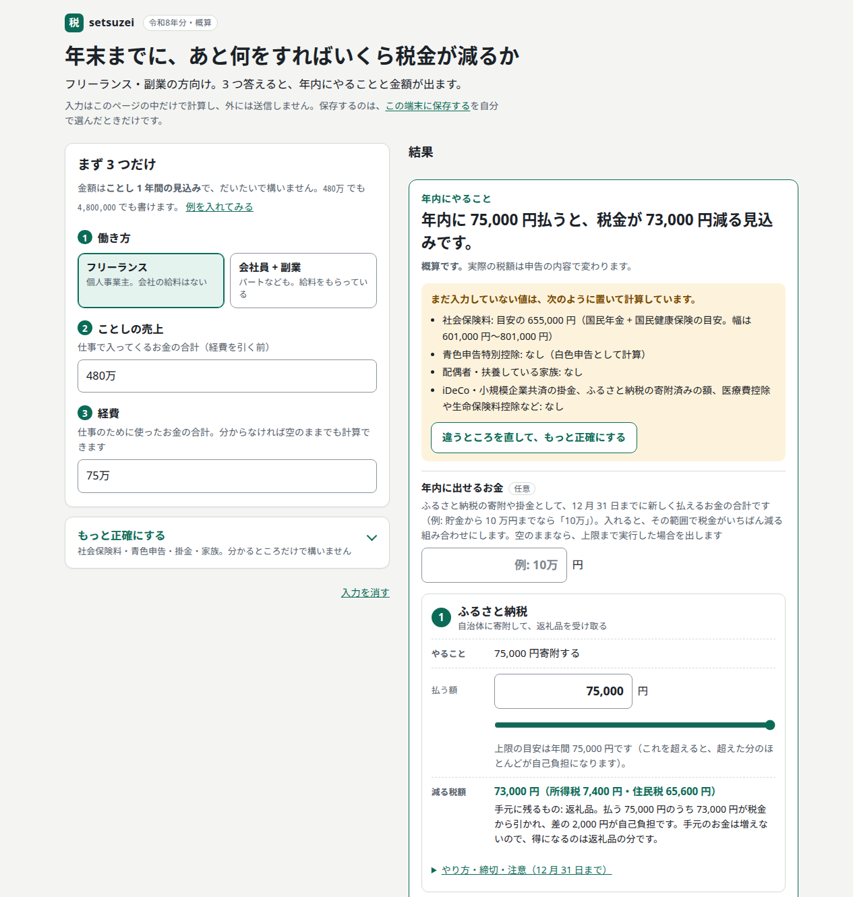
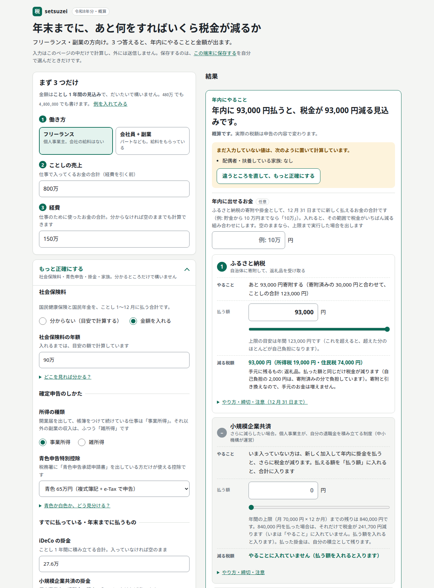

11月も終わりになると、フリーランスや副業の人は同じことで迷います。ふるさと納税はあといくらまでか。iDeCo や小規模企業共済を増やすと、いくら税金が減るのか。まとめてやると、いくら払って、合計でいくら減るのか。

これを概算する道具を作りました。[setsuzei](https://github.com/ozko00/setsuzei) です。年間の見込みの収入・経費・家族構成を入れると、いまの所得税・住民税の見込みと、**ふるさと納税・iDeCo・小規模企業共済・青色申告特別控除**でそれぞれいくら減るか、そのためにいくら支払うかを出します。令和8年分（2026年分）に対応しています。MIT ライセンスです。

先に、この記事で分かることです。

- 自分の数字を入れると何が出るか（実行した出力をそのまま載せます）
- その数字の根拠は何か（税制の数値をどう持ち、何と突き合わせたか）
- 何は計算しないか

:::message alert
setsuzei が出すのは概算です。税理士や税務署・市区町村の判断に代わるものではありません。重要な判断の前に、必ず専門家か所轄の窓口に確認してください。
:::

:::message
**2026年11月26日に書き直しました。** 公開時の記事（setsuzei 0.2.0）は、「全部やると 393,800 円減る」という数字を先頭に出していました。公開後に独立した監査を受け、この見せ方は誤解を招くと指摘されました。setsuzei を 0.2.2 に直し、この記事の出力例・画面・説明とタイトルも合わせて直しています。何がまずかったかは「[公開後に監査を受けて直したこと](#公開後に監査を受けて直したこと)」に書きました。

**2026年11月27日にもう一度書き直しました。** setsuzei が 0.3.2 になり、ブラウザ版が作り直され、CLI は `npx setsuzei` で動くようになりました。出力例・画面・手順・件数を 0.3.2 で取り直しています。作り直しの経緯は「[初見の利用者役に使わせて直したこと](#初見の利用者役に使わせて直したこと)」に書きました。
:::

この記事の出力例は、2026年11月27日に、npm の `setsuzei@0.3.2` を `npx` で実行したものです。タグ `v0.3.2`（コミット `df92cad`）を手元でビルドしたものとも比べ、最初の例の出力が1文字も違わないことを確かめています。画面は、同じ日に公開中のブラウザ版（0.3.2）を開いて撮りました。

## 入れると何が出るか

例は、売上 800万円・経費 150万円のフリーランスです。青色申告 65万円、社会保険料 90万円、iDeCo は年 27.6万円を拠出する見込みで、ふるさと納税は 3万円を寄附済み、とします。

```console
$ npx setsuzei --revenue 800万 --expenses 150万 --blue 65 --social-insurance 90万 --ideco-paid 27.6万 --furusato-paid 3万
setsuzei 0.3.2 ｜ 令和8年分（2026年分）の概算

■ 現状の見込み
  事業所得（青色申告特別控除 650,000 円を控除後）  5,850,000 円
  合計所得金額                                     5,850,000 円
  所得税の課税所得（税率 20%）                     3,976,000 円
  所得税 + 復興特別所得税                            375,400 円
  住民税（令和9年度・均等割と森林環境税を含む）      404,600 円
  税額の合計                                         780,000 円

■ 年末までにできることと、支払う額・減る税額の目安
                               追加で支払う額    減る税額  うち所得税  うち住民税
  ふるさと納税                      93,000 円   93,000 円   19,000 円   74,000 円
  小規模企業共済                   840,000 円  241,700 円  154,800 円   86,900 円
  iDeCo（年内に増やせる場合）      540,000 円  164,300 円  110,300 円   54,000 円
  ※ それぞれ単独で実行した場合です。減る税額は、追加で支払う額と引き換えです。
  ※ ふるさと納税は、寄附した額とほぼ同じだけ税が減る仕組みです。手元のお金は増えません（得になるのは返礼品の分）。
  ※ iDeCo は原則 60 歳まで引き出せません。掛金額の変更は年 1 回で、年内に増やせるかどうかは加入先と時期しだいです。

  ◆ まとめて実行した場合（ふるさと納税 + 小規模企業共済）
    ふるさと納税の追加           56,000 円
    小規模企業共済の追加        840,000 円
    追加で支払う額の合計        896,000 円
    減る税額の合計              297,700 円
    　うち掛金の追加による分    241,700 円
    　うちふるさと納税による分   56,000 円
    　（所得税）                160,500 円
    　（住民税）                137,200 円
    税額の合計（実行後）        482,300 円
    ・まとめて実行した場合の税額を計算し直した値です。各策の軽減額を足した額とは一致しません。
    ・ふるさと納税による分は、寄附した額から自己負担を引いた額が税から引かれるものです。寄附と同じだけお金が出ていくので、手元のお金は増えません（得になるのは返礼品の分です）。
    ・ふるさと納税は、掛金を追加した後の上限の目安（86,000 円）まで寄附する前提です。
    ・iDeCo の追加は、この合計に含めていません。掛金額の変更は年 1 回で反映にも時間がかかり、年内に増やせるかどうかは加入先と時期しだいのためです。年内に追加できる額がわかっている場合は、その額を指定すると合計に含めます（CLI は --ideco-add、JSON は idecoAdditional、ブラウザ版は「iDeCo に年内に追加できる額」）。

  ◆ iDeCo の追加も年内に間に合う場合（ふるさと納税 + 小規模企業共済 + iDeCo）
    ふるさと納税の追加             43,000 円
    小規模企業共済の追加          840,000 円
    iDeCo の追加                  540,000 円
    追加で支払う額の合計        1,423,000 円
    減る税額の合計                393,800 円
    　うち掛金の追加による分      350,800 円
    　うちふるさと納税による分     43,000 円
    　（所得税）                  214,300 円
    　（住民税）                  179,500 円
    税額の合計（実行後）          386,200 円
    ・iDeCo の追加（残り枠）も年内に間に合う場合の合計です。間に合うかどうかは加入先（運営管理機関）に確認してください。
    ・まとめて実行した場合の税額を計算し直した値です。各策の軽減額を足した額とは一致しません。
    ・ふるさと納税による分は、寄附した額から自己負担を引いた額が税から引かれるものです。寄附と同じだけお金が出ていくので、手元のお金は増えません（得になるのは返礼品の分です）。
    ・ふるさと納税は、掛金を追加した後の上限の目安（73,000 円）まで寄附する前提です。
```

金額は 0.2.2 のときと同じです。0.3.0 以降、税額の計算は変わっていません（リリースノートにそう書いてあり、この例では実際に同じ数字でした）。

このあとに、策ごとの内訳・注意点・「ことばの説明」・免責が続きます。青色申告の区分ごとの差も出ます。

```console
  ◆ 青色申告特別控除
                          税額の合計     現在との差
    白色申告（控除なし）  977,700 円  197,700 円 増
    青色 10万円           947,300 円  167,300 円 増
    青色 55万円           810,400 円   30,400 円 増
    青色 65万円           780,000 円       （現在）
```

### 軽減額は、足しても合計になりません

まず見てほしいのは、「まとめて実行した場合」の欄です。CLI の既定では、ふるさと納税と小規模企業共済の2つをまとめます。

| | 追加で支払う額 | 減る税額 |
|---|---|---|
| ふるさと納税（単独） | 93,000 円 | 93,000 円 |
| 小規模企業共済（単独） | 840,000 円 | 241,700 円 |
| 上の2つを足した額 | 933,000 円 | 334,700 円 |
| **2つをまとめて計算し直した額** | **896,000 円** | **297,700 円** |

減る税額の差は 37,000 円です。共済の掛金で住民税の所得割額が減ると、ふるさと納税の上限も下がるからです。この例では、上限の目安が 123,000 円から 86,000 円になります。3万円は寄附済みなので、追加できるのは 93,000 円ではなく 56,000 円です。差の 37,000 円は、この分です。

策ごとの軽減額を足して予定を立てると、ふるさと納税を上限より多く寄附してしまうことがあります。上限を超えた分は自己負担が増えます。setsuzei は、まとめて実行した場合の税額を最初から計算し直します。

iDeCo の追加も年内に間に合う場合は、差がもっと大きくなります。その下の欄の数字です。

| | 追加で支払う額 | 減る税額 |
|---|---|---|
| 上の2つ + iDeCo（単独で 540,000 円払って 164,300 円減）を足した額 | 1,473,000 円 | 499,000 円 |
| **3つをまとめて計算し直した額** | **1,423,000 円** | **393,800 円** |

こちらの差は 105,200 円です。ふるさと納税の上限が 73,000 円まで下がることに加えて、掛金どうしも足し算になりません。掛金による分は、単独の額を足すと 241,700 + 164,300 = 406,000 円ですが、まとめると 350,800 円です。掛金を入れるほど課税所得が減り、この例では途中で所得税の税率の区分が下がるためです。

### 減る税額は、支払う額と引き換えです

出力は、減る税額の隣に「追加で支払う額」を並べます。この例で 297,700 円を減らすには、896,000 円を支払います。

- **ふるさと納税による分（56,000 円）は、手元のお金を増やしません。** 寄附した額から自己負担を引いた額が、税から引かれる仕組みです。寄附と同じだけお金が出ていきます。得になるのは返礼品の分です。出力は、減る税額を「掛金の追加による分」と「ふるさと納税による分」に分けて出します。
- **小規模企業共済の 840,000 円は、なくなるお金ではありませんが、すぐには使えません。** 出力の注意には、受け取るときに課税されること、任意解約は掛金納付月数が 240 か月未満だと受取額が掛金の合計を下回ることが出ます。
- **iDeCo は原則 60 歳まで引き出せません。**

「いくら減るか」だけを見て決めるものではない、ということです。

### iDeCo の追加は、既定では合計に入れません

出力には、策ごとの注意も付きます。iDeCo にはこの行が出ます。

```text
・年内に増やせるかどうかは、加入先（運営管理機関）と時期しだいです。掛金額の変更は 1 年（12 月分〜翌年 11 月分）に 1 回だけで、まとめて拠出するには事前に年単位拠出（月別指定）の届出が必要です。届出は申請の翌月分（翌々月の引落し）からの反映で、過ぎた月の分をあとから納めることはできません。今年の控除になるのは、12 月の引落し分までです。
```

年末が近いと、今年分の iDeCo はもう増やせないことがあります。そこで setsuzei は、iDeCo の追加を「まとめて実行した場合」の合計に入れず、「年内に間に合う場合」として別の欄に出します。加入先に確認して、年内に追加できる額が分かっている場合は、`--ideco-add` でその額を指定すると合計に入ります。

setsuzei が出すのは「枠がいくら残っていて、埋めるといくら減るか」です。手続きが年内に間に合うかは判定しません。iDeCo も小規模企業共済も、加入先に確認してください。

### ブラウザ版は、同じ入力でも先頭の数字が違います

0.3.0 から、ブラウザ版は CLI より控えめな数字を先頭に出します。上と同じ入力をブラウザ版に入れると、先頭はこうなります。

```text
年内に 93,000 円払うと、税金が 93,000 円減る見込みです。
```

CLI の「896,000 円払って 297,700 円減る」ではありません。この例の人は小規模企業共済に入っていない（支払済みが 0 円）ので、ブラウザ版は共済の 840,000 円を「年内にやること」の合計に入れないからです。共済は「さらに減らしたい場合」として別に出て、「840,000 円を払った場合は、それだけで税金が 241,700 円減ります」と書かれます。

共済の「払う額」に 840,000 円を入れると、先頭は「年内に合わせて 896,000 円払うと、税金が 297,700 円減る見込みです」に変わり、CLI と同じ数字になります。計算は同じで、何を既定の合計に入れるかが違います。

| | 既定の合計に入れるもの | この例の先頭の数字 |
|---|---|---|
| CLI | ふるさと納税 + 小規模企業共済の残り枠 | 896,000 円払って 297,700 円減る |
| ブラウザ版 | ふるさと納税。共済は、加入済みの人か、払う額を入れたときだけ | 93,000 円払って 93,000 円減る |

なお、この 93,000 円はふるさと納税の分です。寄附と引き換えなので、手元のお金は増えません。画面にもそう出ます。

## 公開後に監査を受けて直したこと

この記事は、最初は setsuzei 0.2.0 の出力で書きました。公開後に独立した監査を受けて、表示と計算に問題が見つかりました。0.2.2 で直したことを、5つ書きます。「0.2.0 では」の数字は、手元に残っていた 0.2.0 で同じ入力を実行して確かめたものです。

**1. 先頭の数字が、年内に実行できないことがある策を含んでいた。** 0.2.0 は、まとめの欄を「全部やった場合（ふるさと納税 + iDeCo + 小規模企業共済）」とし、ブラウザ版の先頭にも「全部やると減る税額」を出していました。この記事のタイトルも「全部やるといくら減る？」で、本文は 393,800 円を結論のように扱っていました。しかし iDeCo の掛金額の変更は年1回で、年内に増やせるかは加入先と時期しだいです。年末に読んだ人が、実行できない額を「減らせる額」と受け取るおそれがありました。0.2.2 の先頭は、iDeCo の追加を含まない 297,700 円です。

**2. 減る税額だけが目立ち、支払う額が隣になかった。** 393,800 円を減らすには 1,423,000 円を支払います。0.2.0 もこの額を出してはいました。ただ、ブラウザ版の先頭に出るのは「全部やると減る税額」だけで、支払う額は下の内訳まで読まないと分かりませんでした。0.2.2 は、減る税額と支払う額を並べて出します。

**3. ふるさと納税の分を、節約できる額のように見せていた。** ふるさと納税で税が減るのは、同じだけ寄附するからです。手元のお金は増えません。0.2.0 はこれを掛金の分と合算して「減る税額」としていました。0.2.2 は分けて出し、注記を付けています。

**4. 税額がもう減らない掛金まで提案していた。** 売上 200万円・経費 50万円・社会保険料 30万円の入力で、0.2.0 は「1,656,000 円を追加で支払うと 82,600 円減る」と出していました。0.2.2 は同じ入力で「769,000 円で 82,600 円」です。それを超える掛金は、税額を減らさないからです。

**5. 住民税の所得割の非課税限度額を計算していなかった。** 所得が少なく、家族が多い世帯では、住民税の所得割がかかりません。0.2.0 にはこの判定がなく、判定に必要な 16歳未満の子の人数を入れる欄もありませんでした。売上 215万円・社会保険料 35万円・配偶者と 16歳未満の子 3人、という世帯で比べます。0.2.0 は住民税 104,000 円、ふるさと納税の上限の目安 25,000 円と出しました（子は入力できません）。0.2.2 に `--dependents-under16 3` を付けると、住民税は 5,000 円（均等割と森林環境税だけ）で、ふるさと納税の上限は出しません。寄附しても住民税が減らないからです。

1〜3 は、計算が間違っていたのではなく、見せ方の問題です。数字が正しくても、並べ方しだいで「これだけ得をする」と読めてしまいます。この記事の公開時の版も、同じ見せ方をしていました。

## 初見の利用者役に使わせて直したこと

監査のあと、ブラウザ版の使い勝手を確かめました。0.3.0〜0.3.2 は、その結果で直した版です。

先に、この節の数字の出どころを書きます。

- **利用者役は人間ではありません。** setsuzei を知らない AI エージェントです。毎回新しく起動し、人物像と課題だけを渡して、実際のブラウザを「画面を見る・座標を押す・文字を打つ」だけで操作させています。そのための道具は、リポジトリの [`scripts/persona-browser.mjs`](https://github.com/ozko00/setsuzei/blob/v0.3.2/scripts/persona-browser.mjs) です。
- **確信度・回数・役の答えは、開発時の確認の記録から引いた数字です。** 公開されているのは、確認をしたこと（[PR #10](https://github.com/ozko00/setsuzei/pull/10)、[PR #11](https://github.com/ozko00/setsuzei/pull/11)）、直した内容（リリースノート）、やり方（CONTRIBUTING.md）までです。確信度の数字はリポジトリには載っていません。私はこの確認をやり直していません。
- 「いまの版では」と書いたところは、公開中の 0.3.2 を私が操作して確かめたものです。

人物像は5つです。開業1年目の人、会社員で副業のある人、子が2人いる個人事業主、所得が低い人、税の用語を知らない人。5人に4回ずつ使わせ、そのあと2人だけ5回目を行っています。

**直す前に分かったこと。** 0.2.4 の画面は、小規模企業共済に入っていない人にも、共済の上限まで払う前提の合計を先頭に出していました。記録では、開業1年目の役が読み取った答えは「867,000 円払うと 154,000 円減る」です。用語を知らない役は「84万円払うのは損に見える」と答えています。共済に入っていない人にとっては、年内に実行しにくい額を先頭に出していたことになります。

**直したこと。**

- 最初に聞くのを、働き方・売上・経費の3つだけにしました。残りは目安や既定の値を置き、何をどう置いたかを結果に出します。
- 結果の先頭を「年内にやること」にしました。やること・払う額・減る税額を1つずつ並べます。
- 入っていない小規模企業共済は、既定の合計に入れないことにしました。記録では、開業1年目の役の答えは「47,000 円払うと 47,000 円減る」に変わっています。
- 「年内に出せるお金」を入れると、その範囲で配分します。
- 各項目に、やり方と公式ページへのリンクを付けました。結果を文章でコピーする機能と、印刷する機能、入力をこの端末に保存する機能（自分で選んだときだけ）も足しています。

**うまくいかなかったこと。** 役には毎回、答えにどのくらい確信があるかを答えさせています。5人の平均は、直す前（0.2.4）が 51%、作り直しの途中の版が 64%、0.3.0 に当たる版が 59%、0.3.1 の直しを入れた版が 60% でした。51% から 60% 前後で、大きくは伸びていません。途中より下がってもいます。エージェントの自己申告で、5人だけの数字なので、目安として見てください。記録に残っている理由は、入力のたびに結果の数字が変わること、共済や iDeCo を「やるかどうか」を自分では決められないこと、です。「やり方」は足しましたが、開いて読んだ役はいませんでした。

**途中で不具合も入れました。** 4回目の確認で、会社員で副業のある役が間違った答えを持ち帰っています。正しい答えは「80,000 円払うと 80,100 円減る」ですが、役が読み取ったのは「58,000 円払うと 58,100 円減る」でした。「配偶者がいる」にチェックだけ入れて所得を空のままにすると、所得 0 円の配偶者として計算され、配偶者控除が入っていたからです。ふるさと納税の上限は 110,000 円から 88,000 円に下がっていました。役は気づいていません。原因は、その前の回のあとに書き換えた欄の説明でした。

0.3.1 で、チェックしただけでは配偶者なしで計算するように直しています。記録では、5回目に同じ役が正しい答えになりました。いまの版では、この記事の例で「配偶者がいる」にチェックだけ入れても、先頭は 93,000 円のままで、「所得（または給料の年収）を入れるまでは、配偶者なしで計算しています」と出ます。配偶者の給料の年収に 0 を入れると、上限の目安は 123,000 円から 113,000 円に下がります。直す前は、チェックしただけでこの低いほうの数字が出ていたことになります。

**確かめていない直しもあります。** 所得が低い役の確信度は、40% → 60% → 60% → 40% → 45% でした。この役の結果は「年内にやることはない」です。0.3.2 で文面を3か所直していますが、その版では利用者役の確認をしていません。「やることがない人に何を見せるか」は、まだ解けていません。

## 試し方

### ブラウザ版

まずはこちらを試してください。インストールは要りません。[https://ozko00.github.io/setsuzei/](https://ozko00.github.io/setsuzei/) を開いて、働き方・売上・経費の3つに答えると結果が出ます。「例を入れてみる」を押すと、入力例（フリーランス・売上 480万円・経費 75万円）が入ります。



上の画面は、公開中のページで「例を入れてみる」を押したところです。先頭は「年内に 75,000 円払うと、税金が 73,000 円減る見込みです」。その下に、仮に置いた値が出ます。社会保険料は、目安の 655,000 円（幅は 601,000〜801,000 円）で計算しています。この目安は、国民年金の定額と、3つの市区の国民健康保険の料率から出したものだと、リリースノートにあります。実際の額とは違うので、分かる人は「もっと正確にする」を開いて入れてください。

画面が置いた値を CLI に渡すと、同じ数字になります。

```console
$ npx setsuzei --revenue 480万 --expenses 75万 --social-insurance 655000 --kyosai-add 0
（中略）
  税額の合計                                       439,800 円
（中略）
                               追加で支払う額    減る税額  うち所得税  うち住民税
  ふるさと納税                      75,000 円   73,000 円    7,400 円   65,600 円
```

次の画面は、この記事の最初の例と同じ入力です。URL に CLI と同じ名前のパラメータを付けて開きました（`?revenue=800万&expenses=150万&blue=65&social-insurance=90万&ideco-paid=27.6万&furusato-paid=3万`）。



先頭は「年内に 93,000 円払うと、税金が 93,000 円減る見込みです」。小規模企業共済は「さらに減らしたい場合」として下に出ています。上の「[ブラウザ版は、同じ入力でも先頭の数字が違います](#ブラウザ版は、同じ入力でも先頭の数字が違います)」で書いたとおりです。

ほかに、公開中のページで確かめたことです。

- **年内に出せるお金**: この例で `5万` と入れると、ふるさと納税が「あと 50,000 円寄附する」になりました。
- **やり方と公式リンク**: ふるさと納税・小規模企業共済・iDeCo の「やり方・締切・注意」を開くと、手順と、総務省・国税庁・中小機構・iDeCo 公式サイトへのリンクが出ます。
- **保存**: 「入力をこの端末に保存する」は、既定ではオフです。開いた直後、ブラウザの保存領域（localStorage）は空でした。チェックを入れるとキーが1つ入り、外すと消えました。
- **コピー・印刷**: 「結果を文章でコピー」「印刷する」のボタンがあります。ボタンがあることは見ましたが、コピーされる文面と印刷の体裁までは確かめていません。
- **令和7年分との比較**: 「[ふるさと納税の上限は令和8年分で下がる？](https://ozko00.github.io/setsuzei/furusato-nozei-jogen-reiwa8/)」というページが増えました。内容は[下の節](#令和8年分では、同じ収入でも上限が変わる)で触れます。

CLI とブラウザ版は同じ計算コアを使っています。入力した内容は、ページの中だけで計算します。ページの HTML には次の CSP を入れてあり、外部への通信を禁止しています。

```html
<meta http-equiv="Content-Security-Policy" content="default-src 'none'; script-src 'self'; style-src 'self'; img-src 'self' data:; connect-src 'none'; base-uri 'none'; form-action 'none'">
```

### CLI

コマンドラインで使いたい人向けです。npm に公開されたので、Node.js 20 以上があれば、インストールなしで実行できます。

```sh
npx setsuzei          # 対話形式で入力
npx setsuzei --revenue 800万 --expenses 150万 --blue 65 --social-insurance 90万
```

はじめて実行するときに、npm から [setsuzei](https://www.npmjs.com/package/setsuzei) を取得します。実行時の依存パッケージはありません。この記事と同じ版を使いたいときは、`npx setsuzei@0.3.2` と版を付けます。

手元（Node.js 26、npm 12）では、空のフォルダで `npx --yes setsuzei` を実行して、0.3.2 が動きました。npm 12 では、標準エラーに `npm notice run npx` のような行が出ます。計算結果は標準出力なので、混ざりません。

npm には、リポジトリのタグを push したときに GitHub Actions が公開します。認証は npm の Trusted Publishing で、トークンは置いていません（[CONTRIBUTING.md](https://github.com/ozko00/setsuzei/blob/v0.3.2/CONTRIBUTING.md) の「リリースの手順」）。`npm view setsuzei@0.3.2 dist.attestations` を実行すると、provenance（`https://slsa.dev/provenance/v1`）が付いていることを確かめられます。

npm を使わない場合は、ソースを取得してビルドします。git が必要です。

```sh
git clone --depth 1 --branch v0.3.2 https://github.com/ozko00/setsuzei.git
cd setsuzei
npm ci
npm run build
node dist/cli.js --revenue 800万 --expenses 150万 --blue 65 --social-insurance 90万
```

以下の例は `npx setsuzei` で書きます。金額は `600万` / `6,000,000` / `6000000` のどれでも書けます。すべて**年間の見込み額**です。会社員の副業なら、給与収入を `--salary` で足します。16歳未満の子がいる場合は、人数を `--dependents-under16` で入れます。

```sh
# 会社員の副業（雑所得）、配偶者控除あり、高校生の子 1 人
npx setsuzei --salary 600万 --revenue 120万 --expenses 20万 --misc \
  --social-insurance 88万 --spouse-income 0 --dependents 1
```

この入力では、税額の合計が 553,300 円、ふるさと納税の上限の目安が 86,000 円、iDeCo を年内に残り枠の 276,000 円まで増やせる場合の軽減額が 55,800 円、と出ました。給与収入がある人や雑所得の人は、小規模企業共済を対象外として扱います。この入力では軽減額の行は出ず、「給与収入があるため計算していません」という注意が出ました。

`--json` を付けると JSON で出ます。入力も JSON で渡せます。

```sh
echo '{"businessRevenue":8000000,"businessExpenses":1500000,"blueReturn":"65","socialInsurance":900000}' \
  | npx setsuzei --input - --json
```

入力に誤りがあると、終了コード 2 で終わります。`--json` を付けていれば、標準エラーに問題の一覧が出ます。

```console
$ echo '{"businessRevenue":-1,"blueReturn":"70"}' | npx setsuzei --input - --json
{
  "error": {
    "message": "入力に誤りがあります:\n  - businessRevenue: 0 以上の整数（円）で指定してください（受け取った値: -1）\n  - blueReturn: \"none\" / \"10\" / \"55\" / \"65\" のいずれかで指定してください",
    "issues": [
      "businessRevenue: 0 以上の整数（円）で指定してください（受け取った値: -1）",
      "blueReturn: \"none\" / \"10\" / \"55\" / \"65\" のいずれかで指定してください"
    ]
  }
}
$ echo $?
2
```

## 数字の根拠1: 税制の数値を年分ごとのデータに分けた

ここからは作りの話です。税金の計算ツールでいちばん怖いのは、式の間違いより、**古い数値が残ること**だと考えました。令和8年分は基礎控除と給与所得控除が変わった年で、前の年の数字をそのまま使うと合わないことがあります。

そこで、税率・控除額・上限などの数値を計算コードから切り離し、年分ごとの1ファイルにまとめました。令和8年分は [`src/data/2026.ts`](https://github.com/ozko00/setsuzei/blob/main/src/data/2026.ts) です。数値ごとに、出典の URL をコメントで付けています。基礎控除の部分はこうなっています。

```ts
    // 基礎控除（令和 8 年分・令和 9 年分）
    // 出典: 国税庁 No.1199 基礎控除
    // https://www.nta.go.jp/taxes/shiraberu/taxanswer/shotoku/1199.htm
    basicDeduction: [
      { upTo: 489 * MAN, value: 104 * MAN },
      { upTo: 655 * MAN, value: 67 * MAN },
      { upTo: 2_350 * MAN, value: 62 * MAN },
      { upTo: 2_400 * MAN, value: 48 * MAN },
      { upTo: 2_450 * MAN, value: 32 * MAN },
      { upTo: 2_500 * MAN, value: 16 * MAN },
      { upTo: null, value: 0 },
    ],
```

決めたことは3つです。

- **金額は円の整数、割合は整数（パーセントや千分率）で持つ**。復興特別所得税の 2.1% は `reconstructionPermille: 21` です。計算の途中で浮動小数の誤差を出さないためです。
- **計算コード（`src/core/`）には税制の数値を書かない**。計算は `TaxYearData` 型のデータを受け取る純粋関数で、実行時の依存パッケージはありません。
- **「入れなかった改正」も理由と一緒にコメントに書く**。たとえば iDeCo の拠出限度額の引上げは 2026年12月の施行ですが、12月分の掛金は翌年1月の納付になるため、令和8年分には反映していません。その旨と出典をデータの横に書いています。

出典の一覧は、CLI からも出せます。

```console
$ npx setsuzei --sources
国税庁 令和8年度税制改正による所得税の基礎控除の引上げ等について
  https://www.nta.go.jp/users/gensen/2026kiso/index.htm
国税庁 No.2260 所得税の税率
  https://www.nta.go.jp/taxes/shiraberu/taxanswer/shotoku/2260.htm
国税庁 No.1199 基礎控除
  https://www.nta.go.jp/taxes/shiraberu/taxanswer/shotoku/1199.htm
（以下略。全部で 38 件）
```

38件の内訳は、国税庁が14件、e-Gov の法令が7件、iDeCo 公式サイトが4件、中小機構が3件、総務省・財務省・国民年金基金連合会が2件ずつ、厚生労働省・江戸川区・練馬区・生駒市が1件ずつです。0.2.2 のときは33件でした。増えた分には、ふるさと納税の上限を令和7年分と比べるための根拠（地方税法の令和8年4月施行の条文、財務省の改正の解説、練馬区・生駒市の説明）が入っています。同じ一覧は、ブラウザ版の結果の下の「根拠にした一次情報」にも出ます。

## 数字の根拠2: 公表されている表と突き合わせた

データに出典を付けても、式を間違えていれば結果は違います。そこで、役所などが公表している計算例と同じ結果になるかをテストにしました。テストは `node:test` で 206件あり、手元ではすべて通っています（0.2.2 のときは 138件）。

### ふるさと納税の上限は、総務省の表と比べた

ふるさと納税の上限の目安は、次の式で出しています。

```text
上限の目安 = 住民税所得割額 × 20% ÷（90% − 所得税率 × 1.021）+ 2,000 円
（1,000 円未満は切り捨て）
```

最初の例で確かめます。`--json` の出力では、寄附金税額控除を引く前の住民税所得割額（`incomeLevyBeforeDonation`）が 421,900 円、所得税率が 20% です。

```text
421,900 × 20% = 84,380
90% − 20% × 1.021 = 69.58%
84,380 ÷ 0.6958 = 121,270.4…
121,270 + 2,000 = 123,270 → 123,000 円
```

CLI が出した 123,000 円と合います。ただ、これは自分で書いた式を自分で検算しただけです。外の数字とも比べる必要があります。

総務省の資料「[ふるさと納税制度とは](https://www.soumu.go.jp/main_content/000816463.pdf)」に、「全額控除されるふるさと納税額（年間上限の目安）」という表があります。

| 給与収入 | 独身 | 夫婦＋子1人 | 夫婦＋子2人 |
|---|---|---|---|
| 500万円 | 6.1万円 | 4.0万円 | 2.8万円 |
| 750万円 | 11.8万円 | 8.7万円 | 7.6万円 |
| 1,000万円 | 18.0万円 | 15.7万円 | 14.4万円 |
| 2,000万円 | 56.9万円 | 55.2万円 | 53.6万円 |

この表との突き合わせには、2つの問題がありました。

**1つ目は、表が古い税制で作られていることです。** PDF のファイル情報では 2022年4月の作成で、所得税の基礎控除が 48万円だった時期です。令和8年分のデータのまま計算しても合いません。そこでテストでは、令和8年分のデータのうち**所得税の基礎控除だけを当時の額に差し替えたデータ**を作り、同じ計算エンジンに渡しています。データと計算を分けてあったので、数行で書けました。

```ts
const data = getTaxYear(2026);
const tableEra: TaxYearData = {
  ...data,
  incomeTax: {
    ...data.incomeTax,
    // 令和 2 年分〜令和 6 年分の基礎控除（国税庁 No.1199 の「令和6年分以前」の列）
    basicDeduction: [
      { upTo: 24_000_000, value: 480_000 },
      { upTo: 24_500_000, value: 320_000 },
      { upTo: 25_000_000, value: 160_000 },
      { upTo: null, value: 0 },
    ],
  },
};
```

**2つ目は、資料に計算の前提が書かれていないことです。** 社会保険料をいくらと置いたのか、子は何歳なのかが分かりません。テストでは次の前提を置きました。

- 社会保険料は給与収入の 15%
- 「夫婦」は配偶者に所得がなく、配偶者控除を受ける
- 「子1人」は高校生、「子2人」は大学生と高校生

結果はこうです。かっこの中は、計算値から表の値を引いた差です。

| 給与収入 | 独身 | 夫婦＋子1人 | 夫婦＋子2人 |
|---|---|---|---|
| 500万円 | 一致（6.1万円） | 一致（4.0万円） | 一致（2.8万円） |
| 750万円 | 一致（11.8万円） | 一致（8.7万円） | 一致（7.6万円） |
| 1,000万円 | 17.7万円（−3,000 円） | 15.3万円（−4,000 円） | 14.0万円（−4,000 円） |
| 2,000万円 | 52.0万円（−49,000 円） | 50.3万円（−49,000 円） | 48.7万円（−49,000 円） |

- **500万円・750万円の6マスは、千円単位まで一致しました。**
- **1,000万円・2,000万円の6マスは一致しません。** 1,000万円の行は 3,000〜4,000 円、2,000万円の行は3マスとも 49,000 円、表より低く出ます。

「12マス全部が一致した」とは書けません。差が残る行は、差の額をそのままテストの期待値にしています。前提を表に合わせて動かすことはしていません。

差の原因として考えているのは、社会保険料の前提です。高収入の行では、表が社会保険料を 15% より低く置いているように見えます。ただ、資料に前提の記載がないので、確認はできていません。setsuzei は社会保険料を入力値のまま使うので、実際の額を入れれば、この前提の違いは利用時の結果には影響しません。

### 所得金額調整控除を入れても、差は縮まらなかった

バージョン 0.2.0 で、所得金額調整控除を実装しました。給与収入が 850万円を超えて、23歳未満の扶養親族などがいる場合に、給与所得から引く控除です。表の 1,000万円・2,000万円の「夫婦＋子」のマスが該当します。

ただ、実装しても、表との差そのものは小さくなりませんでした。同じ前提で、控除を入れない場合と入れた場合の差を並べます。

| マス | 控除を入れない場合 | 入れた場合（0.2.0 以降） |
|---|---|---|
| 1,000万円・独身 | −3,000 円 | −3,000 円 |
| 1,000万円・夫婦＋子1人 | +1,000 円 | −4,000 円 |
| 1,000万円・夫婦＋子2人 | +1,000 円 | −4,000 円 |
| 2,000万円・独身 | −49,000 円 | −49,000 円 |
| 2,000万円・夫婦＋子1人 | −44,000 円 | −49,000 円 |
| 2,000万円・夫婦＋子2人 | −44,000 円 | −49,000 円 |

子ありのマスは、差の大きさで見るとむしろ広がっています。変わったのは差の出方です。入れる前は、独身と子ありで差が食い違っていました。入れた後は、行ごとにほぼ同じ額にそろいました。「独身と比べて、子がいると上限がいくら下がるか」は、表と 1,000 円以内で合います。

つまり、家族構成による違いは表と合うようになり、残った差は家族構成によらない要因に絞られました。その要因が社会保険料の前提なのかどうかは、上に書いたとおり未確認です。

### 令和8年分では、同じ収入でも上限が変わる

突き合わせの途中で、気づいたことがあります。給与収入 500万円・独身は、総務省の表では 6.1万円です。令和8年分で計算すると 5.7万円になります。

```console
$ npx setsuzei --salary 500万 --social-insurance 75万
■ 現状の見込み
  給与所得                                       3,560,000 円
  合計所得金額                                   3,560,000 円
  所得税の課税所得（税率 5%）                    1,770,000 円
（中略）
                               追加で支払う額   減る税額  うち所得税  うち住民税
  ふるさと納税                      57,000 円  55,000 円    2,800 円   52,200 円
```

基礎控除の引上げで、上限の式に使う所得税率の区分が 10% から 5% に変わります。すると、上の式の分母（90% − 所得税率 × 1.021）が大きくなり、上限の目安は小さくなります。所得税そのものは基礎控除の分だけ下がっているので、損をしているわけではありません。ただ、古い早見表の「6.1万円」まで寄附すると、上限を超えます。

税率の区分が変わらない 750万円の3マスは、令和8年分のデータでも表と同じ値でした。これもテストにしています。

0.2.3 から、この比較そのものが機能になりました。令和7年分と令和8年分の上限を並べる関数（`compareFurusatoLimit`）と、[比較のページ](https://ozko00.github.io/setsuzei/furusato-nozei-jogen-reiwa8/)です。手元でビルドした 0.3.2 で、社会保険料を給与収入の 15% として関数を実行した結果です。

| 給与収入（独身） | 令和7年分 | 令和8年分 |
|---|---|---|
| 300万円 | 28,000 円 | 28,000 円 |
| 500万円 | 61,000 円 | 57,000 円 |
| 750万円 | 118,000 円 | 118,000 円 |
| 1,000万円 | 177,000 円 | 177,000 円 |

この4つの中で下がるのは 500万円だけです。「令和8年分は上限が下がる」と一律には言えません。関数は理由も返します。500万円の場合は、割合を決める金額（住民税の課税総所得金額 − 人的控除差調整額）が 2,130,000 円から 1,770,000 円になり、当てはまる所得税率の区分が変わった、という説明でした。根拠の条文（地方税法 第314条の7第11項第1号）は、比較のページと README に書いてあります。条文そのものは、私は読んでいません。

### ほかに突き合わせたもの

- 国税庁: 所得税の具体例（No.2260）、給与所得の表（No.1410）、「源泉所得税の改正のあらまし」の基礎控除と給与収入の対応表
- 中小機構: 掛金の節税額一覧表（課税所得 5通り × 掛金 4通り）
- 地方税法: ふるさと納税の特例分の割合（84.895% など）が、附則第5条の6 の割合と一致すること

このほかに、税率や控除額が切り替わる境界値のテストと、条文の式から手計算した期待値のテストがあります。CLI とブラウザ版が同じ入力で同じ数字を出すことも、9通りの入力でテストしています。作り直した画面については、画面が計算に使った値（目安で置いた社会保険料を含む）を CLI に渡すと同じ結果になることを、別に 10通りでテストしています。

0.2.3 からは、ヘッドレスの Chrome で公開ページを実際に操作するテスト（`npm run test:browser`）もあります。画面の金額を同じ入力の CLI の結果と突き合わせるもので、手元では 32件すべて通りました。CI は Node.js 20 / 22 / 24 と、npm 12 を入れた Node.js 26 で回し、ブラウザのテストは別のジョブで実行しています。

## Agent Skill: モデルに暗算させない

setsuzei には、Claude Code などのエージェントから使うための Skill（[`skills/setsuzei/SKILL.md`](https://github.com/ozko00/setsuzei/blob/main/skills/setsuzei/SKILL.md)）も入っています。「今年あといくら節税できる？」と聞かれたときに、エージェントが必要な項目を質問して、答える、という使い方です。

この Skill の設計は1つの方針でできています。**モデルに税額を計算させない**ことです。

LLM が「年収 800万円のフリーランスです。ふるさと納税の上限は？」に数字で答えたとします。その数字が令和8年分の基礎控除で計算されたものかは、会話からは分かりません。税率を記憶から引いていれば、去年の数字かもしれません。

そこで SKILL.md の「守ること」の先頭には、こう書いてあります。

```markdown
- **税額を自分で計算しない。** 税率・控除額・上限を記憶から答えない。数字は必ず `setsuzei` CLI の出力から引用する。暗算・概算・「だいたい◯%」も行わない。
- CLI を実行できないときは、計算できないと伝える。推測の数字で代用しない。
```

役割の分け方は次のとおりです。

| 担当 | やること |
|---|---|
| モデル | 聞き取り。答えを JSON のキーに対応させる。CLI の結果を読んで説明する |
| CLI | 税額・上限・軽減額の計算のすべて |

暗算が入りこみやすい場所は、SKILL.md で個別にふさいでいます。

- **単位の変換だけは許す**。「600万」を `6000000` に直すのはモデルの仕事です。それ以外の算術はさせません。
- **配偶者の年収から所得を出すときも CLI を使う**。配偶者控除に必要なのは年収ではなく合計所得金額です。年収しか分からない場合は、CLI を `--salary <年収> --json` で実行して `baseline.salaryIncome` を読むように書いています。モデルが給与所得控除を引くことはしません。
- **条件を変えた比較は、条件ごとに CLI を実行する**。「iDeCo をあと10万円だけなら？」は `idecoAdditional` を指定して再実行します。差額を按分させません。
- **各策の軽減額を足させない**。合計は `measures.combined.saving` を読みます。上で見たとおり、足すと合わないからです。
- **減る税額だけを言わせない**。支払う額（`measures.combined.totalPayment` など）を必ず隣に並べて伝えるように書いています。
- **料率を記憶から答えさせない**。国民健康保険料の料率は自治体ごとに違うので、ユーザーが入力したときだけ使います。

CLI の側も、この使い方に合わせてあります。入力は標準入力の JSON で渡せます。入力の誤りは終了コード 2 と `error.issues` で返るので、モデルは問題の一覧を読んで直せます。計算できなかった策には `applicable: false` と理由が付きます。

もう1つ、Skill には聞き取りと「伝え方」の決まりも書いています。0.3.2 の SKILL.md には、次のことが書いてあります。

- iDeCo の追加は、本人が年内に増やせると確認できている場合だけ `idecoAdditional` に入れる。そうでなければ「加入先に確認して増やせる場合は」と条件を付けて伝える。間に合う前提で話さない。
- ふるさと納税は手元のお金が増えない。合計を伝えるときは、ふるさと納税による分（`savingFromFurusato`）を分けて言う。
- iDeCo は原則 60 歳まで引き出せないこと、小規模企業共済も受け取るときに課税があることを添える。
- 16歳未満の子の人数を必ず聞く。住民税の所得割の非課税限度額に関わるため。
- 回答のたびに、概算であることを添える。
- コマンドに入れてよいのは、半角数字の金額・人数と、決まった選択肢だけ。利用者の文字列をそのままコマンドに入れない。

:::message
この記事では、Skill を入れたエージェントとの会話例は載せていません。載せているのは、Skill が渡すのと同じ形の入力（`--input - --json`）を、私が直接 CLI に渡して実行した結果です。

CLI の入れ方も SKILL.md に書いてあります。0.3.2 の SKILL.md は、版を固定した `npx --yes setsuzei@0.3.1` を使います。取得の前に、npm から取得すること・ほかのパッケージは入らないこと・入力した金額は送信しないこと、の3点を利用者に伝えて、了承を得る決まりです。

固定版が 0.3.2 ではなく 0.3.1 なのは、案内する版を「その時点で npm に公開済みの版」にする決まりだからです（CONTRIBUTING.md）。0.3.1 と 0.3.2 で税額の計算は同じだと、リリースノートにあります。`npx --yes setsuzei@0.3.1 --version` が `0.3.1` を返すことは、手元で確かめました。
:::

## 何を計算しないか

概算の道具なので、計算しないものがあります。主なものです。

- 国民健康保険料の全体額、国民年金保険料・介護保険料の金額
- 個人事業税、消費税（インボイス・2割特例など）、源泉徴収税額・予定納税の精算
- 住民税の均等割の非課税判定、障害者・未成年者・寡婦・ひとり親の非課税、自治体独自の均等割の上乗せや減免
- 分離課税の所得（株式・配当・不動産の譲渡など）、不動産所得、退職所得、一時所得、年金
- 住宅ローン控除などの税額控除、給与と年金の両方がある場合の所得金額調整控除、特定親族特別控除、障害者・ひとり親・寡婦・勤労学生控除
- 損失の繰越控除、青色事業専従者給与
- iDeCo・小規模企業共済の受取時の課税、運用成績、手数料（注意は出しますが、額は計算しません）

前提として簡略化しているところもあります。

- 入力はすべて「年末までの年間見込み額」です。月割りや年の途中の変化は見ません。
- 社会保険料は、入力値をそのまま社会保険料控除にします。
- 住民税は標準税率（所得割 10%、均等割 4,000 円 + 森林環境税 1,000 円）です。所得割は、合計所得金額が非課税限度額以下なら 0 円にします。限度額の人数には 16歳未満の扶養親族も入るので、`--dependents-under16` で入力します。均等割の非課税は判定せず、5,000 円を計上します。
- ふるさと納税の上限は、確定申告をする前提の目安です。ワンストップ特例は扱いません。
- iDeCo の年間上限は、給与収入がなければ月額 68,000 円、あれば「企業年金のない会社員」の月額 23,000 円と仮定します。企業年金がある人・公務員の人は `--ideco-limit` で指定します。
- CLI の「まとめて実行した場合」は、ふるさと納税と小規模企業共済をまとめたものです。iDeCo の追加は、`--ideco-add` で額を指定したときだけ含めます。ブラウザ版の「年内にやること」は、入っていない小規模企業共済も、払う額を入れるまで含めません。
- ブラウザ版で社会保険料を「分からない」にしている間は、目安の額で計算します。目安は実際の額とは違います。
- 税額がそれ以上減らなくなる額を超える掛金は、提案しません。
- 所得金額調整控除（給与収入が 850万円を超え、23歳未満の扶養親族か特別障害者がいる場合）は、`--income-adjustment` を付けたときと、16歳未満か 19〜22歳の扶養親族を入力したときに適用します。16〜18歳の子だけがいる場合や特別障害者がいる場合は、入力からは判別できないので、自分で付けます。付けずに給与収入が 850万円を超えていると、その旨の注意が出ます。
- 加入資格や、青色申告の区分の要件を満たせるかは判定しません。

国民健康保険料については、所得割の料率を `--nhi-rate` で入力したときだけ、青色申告の区分による翌年度の所得割額の差の目安を出します。iDeCo・小規模企業共済・ふるさと納税は、国保料の所得割の算定基礎を減らしません。「iDeCo で国保料も下がる」とは出ないようにしてあります。

全部の一覧は、README の「[何を計算し、何を計算しないか](https://github.com/ozko00/setsuzei#何を計算し何を計算しないか)」にあります。数値の誤りや改正への追随漏れを見つけたら、Issue で知らせてください。数値を直す変更には、一次情報の URL が必要です。

## まだ確かめていないこと

- 実際の確定申告書や住民税の決定通知書との突き合わせ。比べたのは、公表されている計算例・表と、条文の式からの手計算です。
- 総務省の表の 1,000万円・2,000万円の行に残る差の原因。社会保険料の前提の違いとみていますが、資料からは確認できていません。
- 令和9年分以降。データは年分ごとに分けてありますが、入っているのは令和8年分だけです。
- 人間の利用者での確認。「利用者役」は AI エージェントです。確信度の数字も開発時の記録から引いたもので、私は確認をやり直していません。
- 利用者役の確認のあとに入れた直し（0.3.2 の文面の修正など）が効いているかどうか。
- ブラウザ版でコピーされる文面と、印刷の体裁。
- Skill を入れたエージェントとの実際の会話。

## まとめ

- setsuzei は、年末までにふるさと納税・iDeCo・小規模企業共済・青色申告特別控除でいくら税金が減るか、そのためにいくら支払うかを概算します。ブラウザ版・CLI・Agent Skill で使えます。
- 策ごとの軽減額は、足しても合計になりません。例では、ふるさと納税と小規模企業共済を足すと 334,700 円、まとめて計算し直すと 297,700 円でした。そのために支払う額は 896,000 円です。
- 公開時の版は、年内に間に合わないことが多い iDeCo の追加を含む 393,800 円を先頭に出し、支払う額を隣に置いていませんでした。監査を受けて 0.2.2 で直し、この記事も書き直しました。
- 0.3.0〜0.3.2 でブラウザ版を作り直しました。最初の質問は3つで、結果の先頭は「年内にやること」です。入っていない小規模企業共済は既定の合計に入れないので、同じ例でもブラウザ版の先頭は「93,000 円払って 93,000 円減る」になります。
- 作り直しは、初見の利用者役（AI エージェント）5人に使わせながら進めました。記録では、確信度の平均は 51% から 60% 前後にしか伸びず、途中で配偶者の欄の不具合も入れています。不具合は 0.3.1 で直しました。
- 税制の数値は年分ごとのデータに分け、一次情報の URL を付けました。データを差し替えられる作りにしたので、古い税制で作られた総務省の表とも突き合わせられました。12マスのうち6マスは一致し、残りの6マスには 3,000〜49,000 円の差があります。
- Skill は、モデルに聞き取りと説明だけをさせ、計算は CLI に任せます。
- 結果は概算です。重要な判断の前に、税理士か税務署・市区町村に確認してください。

## 参考資料

- setsuzei（リポジトリ）— https://github.com/ozko00/setsuzei — 確認日: 2026-11-27
- setsuzei v0.3.2 のリリース — https://github.com/ozko00/setsuzei/releases/tag/v0.3.2 — 確認日: 2026-11-27（v0.3.0・v0.3.1 のリリースノートも同じ日に読みました）
- setsuzei（npm）— https://www.npmjs.com/package/setsuzei — 確認日: 2026-11-27（`npm view` で版と provenance を確認）
- setsuzei（ブラウザ版）— https://ozko00.github.io/setsuzei/ — 確認日: 2026-11-27
- 総務省「ふるさと納税制度とは」（年間上限の目安の表。PDF のファイル情報では 2022年4月作成）— https://www.soumu.go.jp/main_content/000816463.pdf — 確認日: 2026-11-25
- 総務省 ふるさと納税ポータルサイト「税金の控除について」— https://www.soumu.go.jp/main_sosiki/jichi_zeisei/czaisei/czaisei_seido/furusato/mechanism/deduction.html
- 国税庁「令和8年度税制改正による所得税の基礎控除の引上げ等について」— https://www.nta.go.jp/users/gensen/2026kiso/index.htm
- 国税庁 No.1199 基礎控除 — https://www.nta.go.jp/taxes/shiraberu/taxanswer/shotoku/1199.htm

最後の3件は setsuzei のデータファイルに書いてある出典で、README には 2026-11-24〜26 に閲覧したと書いてあります。出典の全件は `--sources` で出ます。

---

筆者: Kosuke。AIみちしるべ（[https://ai.sanvia.co.jp](https://ai.sanvia.co.jp)）を運営しています（[著者ページ](https://ai.sanvia.co.jp/authors/kosuke)）。この記事の出力例とスクリーンショットは、自分のマシンで setsuzei 0.3.2 を実行して取ったものです（「公開後に監査を受けて直したこと」の 0.2.0 と 0.2.2 の数字は、2026年11月26日にそれぞれの版を実行したものです）。「初見の利用者役に使わせて直したこと」の確信度・回数・役の答えは、開発時の記録から引いています。下書きには Claude Code を使い、数字は実行結果と突き合わせています。
