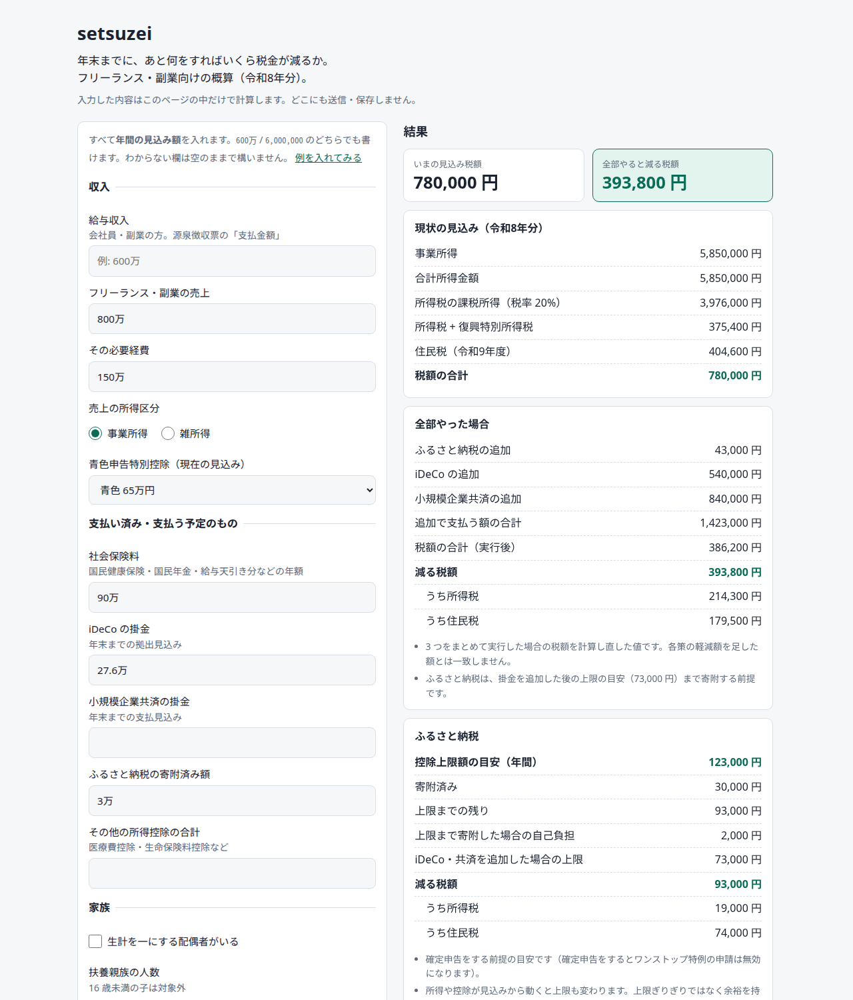

11月も終わりになると、フリーランスや副業の人は同じことで迷います。ふるさと納税はあといくらまでか。iDeCo や小規模企業共済を増やすと、いくら税金が減るのか。全部やると、合計でいくらなのか。

これを概算する道具を作りました。[setsuzei](https://github.com/ozko00/setsuzei) です。年間の見込みの収入・経費・家族構成を入れると、いまの所得税・住民税の見込みと、**ふるさと納税・iDeCo・小規模企業共済・青色申告特別控除**でそれぞれいくら減るかを出します。令和8年分（2026年分）に対応しています。MIT ライセンスです。

先に、この記事で分かることです。

- 自分の数字を入れると何が出るか（実行した出力をそのまま載せます）
- その数字の根拠は何か（税制の数値をどう持ち、何と突き合わせたか）
- 何は計算しないか

:::message alert
setsuzei が出すのは概算です。税理士や税務署・市区町村の判断に代わるものではありません。重要な判断の前に、必ず専門家か所轄の窓口に確認してください。
:::

この記事の出力例は、2026年11月25日に、リポジトリの `main`（コミット `2ad2442`、バージョン 0.2.0）を手元でビルドして実行したものです。

## 入れると何が出るか

例は、売上 800万円・経費 150万円のフリーランスです。青色申告 65万円、社会保険料 90万円、iDeCo は年 27.6万円を拠出する見込みで、ふるさと納税は 3万円を寄附済み、とします。

```console
$ node dist/cli.js --revenue 800万 --expenses 150万 --blue 65 --social-insurance 90万 --ideco-paid 27.6万 --furusato-paid 3万
setsuzei 0.2.0 ｜ 令和8年分（2026年分）の概算

■ 現状の見込み
  事業所得（青色申告特別控除 650,000 円を控除後）  5,850,000 円
  合計所得金額                                     5,850,000 円
  所得税の課税所得（税率 20%）                     3,976,000 円
  所得税 + 復興特別所得税                            375,400 円
  住民税（令和9年度・均等割と森林環境税を含む）      404,600 円
  税額の合計                                         780,000 円

■ 年末までにできることと、減る税額の目安
                                           合計      所得税     住民税
  ふるさと納税（あと 93,000 円）      93,000 円   19,000 円  74,000 円
  iDeCo（あと 540,000 円）           164,300 円  110,300 円  54,000 円
  小規模企業共済（あと 840,000 円）  241,700 円  154,800 円  86,900 円
  ※ それぞれ単独で実行した場合の軽減額です。まとめて実行した場合の合計は下の「全部やった場合」を見てください。

  ◆ 全部やった場合（ふるさと納税 + iDeCo + 小規模企業共済）
    ふるさと納税の追加       43,000 円
    iDeCo の追加            540,000 円
    小規模企業共済の追加    840,000 円
    追加で支払う額の合計  1,423,000 円
    税額の合計（実行後）    386,200 円
    減る税額の合計          393,800 円
    　うち所得税            214,300 円
    　うち住民税            179,500 円
    ・3 つをまとめて実行した場合の税額を計算し直した値です。各策の軽減額を足した額とは一致しません。
    ・ふるさと納税は、掛金を追加した後の上限の目安（73,000 円）まで寄附する前提です。
```

このあとに、策ごとの内訳・注意点・免責が続きます。青色申告の区分ごとの差も出ます。

```console
  ◆ 青色申告特別控除
                          税額の合計     現在との差
    白色申告（控除なし）  977,700 円  197,700 円 増
    青色 10万円           947,300 円  167,300 円 増
    青色 55万円           810,400 円   30,400 円 増
    青色 65万円           780,000 円       （現在）
```

### 3つの軽減額は、足しても合計になりません

この出力でいちばん見てほしいのは、「全部やった場合」の行です。

| | 減る税額 |
|---|---|
| ふるさと納税（単独） | 93,000 円 |
| iDeCo（単独） | 164,300 円 |
| 小規模企業共済（単独） | 241,700 円 |
| 上の3つを足した額 | 499,000 円 |
| **3つをまとめて計算し直した額** | **393,800 円** |

差は 105,200 円です。理由は2つあります。

1. iDeCo と小規模企業共済の掛金を増やすと、課税所得が減ります。この例では、掛金を両方とも上限まで入れると所得税の税率の区分が下がるので、2つ目の掛金は1つ目ほど効きません。
2. 掛金で住民税の所得割額が減ると、ふるさと納税の上限も下がります。この例では 123,000 円から 73,000 円になります。3万円は寄附済みなので、追加できるのは 93,000 円ではなく 43,000 円です。

策ごとの軽減額を足して予定を立てると、ふるさと納税を上限より多く寄附してしまうことがあります。上限を超えた分は自己負担が増えます。setsuzei は、3つをまとめて実行した場合の税額を最初から計算し直します。

### 年末が近いと、間に合わないものもあります

出力には、策ごとの注意も付きます。たとえば iDeCo にはこの行が出ます。

```text
・掛金額の変更は年1回で、手続きから反映まで時間がかかります。年末が近い場合は今年分に間に合わないことがあるので、金融機関（運営管理機関）に確認してください。
```

setsuzei が出すのは「枠がいくら残っていて、埋めるといくら減るか」です。手続きが年内に間に合うかは判定しません。

## 試し方

### ブラウザ版

まずはこちらを試してください。インストールは要りません。[https://ozko00.github.io/setsuzei/](https://ozko00.github.io/setsuzei/) を開いて、数字を入れるだけです。「例を入れてみる」を押すと、入力例が入ります。



上の画面は、CLI の例と同じ入力で公開中のページを開いたものです。税額の合計 780,000 円、全部やると減る税額 393,800 円で、CLI と同じ数字になります。CLI とブラウザ版は同じ計算コアを使っています。

入力した内容は、ページの中だけで計算します。ページの HTML には次の CSP を入れてあり、外部への通信を禁止しています。

```html
<meta http-equiv="Content-Security-Policy" content="default-src 'none'; script-src 'self'; style-src 'self'; img-src 'self' data:; connect-src 'none'; base-uri 'none'; form-action 'none'">
```

### CLI

コマンドラインで使いたい人向けです。Node.js 20 以上と git が必要です。この記事を書いている時点では npm に公開していないので、リポジトリを取得してビルドします。

```sh
git clone https://github.com/ozko00/setsuzei.git
cd setsuzei
npm ci && npm run build
node dist/cli.js --revenue 800万 --expenses 150万 --blue 65 --social-insurance 90万
```

金額は `600万` / `6,000,000` / `6000000` のどれでも書けます。すべて**年間の見込み額**です。会社員の副業なら、給与収入を `--salary` で足します。

```sh
# 会社員の副業（雑所得）、配偶者控除あり、高校生の子 1 人
node dist/cli.js --salary 600万 --revenue 120万 --expenses 20万 --misc \
  --social-insurance 88万 --spouse-income 0 --dependents 1
```

この入力では、税額の合計が 553,300 円、ふるさと納税の上限の目安が 86,000 円、iDeCo を残り枠の 276,000 円まで拠出した場合の軽減額が 55,800 円、と出ました。給与収入がある人や雑所得の人は、小規模企業共済を対象外として扱います。この入力では軽減額の行は出ず、「給与収入があるため計算していません」という注意が出ました。

`--json` を付けると JSON で出ます。入力も JSON で渡せます。

```sh
echo '{"businessRevenue":8000000,"businessExpenses":1500000,"blueReturn":"65","socialInsurance":900000}' \
  | node dist/cli.js --input - --json
```

入力に誤りがあると、終了コード 2 で終わります。`--json` を付けていれば、標準エラーに問題の一覧が出ます。

```console
$ echo '{"businessRevenue":-1,"blueReturn":"70"}' | node dist/cli.js --input - --json
{
  "error": {
    "message": "入力に誤りがあります:\n  - businessRevenue: 0 以上の整数（円）で指定してください（受け取った値: -1）\n  - blueReturn: \"none\" / \"10\" / \"55\" / \"65\" のいずれかで指定してください",
    "issues": [
      "businessRevenue: 0 以上の整数（円）で指定してください（受け取った値: -1）",
      "blueReturn: \"none\" / \"10\" / \"55\" / \"65\" のいずれかで指定してください"
    ]
  }
}
$ echo $?
2
```

## 数字の根拠1: 税制の数値を年分ごとのデータに分けた

ここからは作りの話です。税金の計算ツールでいちばん怖いのは、式の間違いより、**古い数値が残ること**だと考えました。令和8年分は基礎控除と給与所得控除が変わった年で、前の年の数字をそのまま使うと合わないことがあります。

そこで、税率・控除額・上限などの数値を計算コードから切り離し、年分ごとの1ファイルにまとめました。令和8年分は [`src/data/2026.ts`](https://github.com/ozko00/setsuzei/blob/main/src/data/2026.ts) です。数値ごとに、出典の URL をコメントで付けています。基礎控除の部分はこうなっています。

```ts
    // 基礎控除（令和 8 年分・令和 9 年分）
    // 出典: 国税庁 No.1199 基礎控除
    // https://www.nta.go.jp/taxes/shiraberu/taxanswer/shotoku/1199.htm
    basicDeduction: [
      { upTo: 489 * MAN, value: 104 * MAN },
      { upTo: 655 * MAN, value: 67 * MAN },
      { upTo: 2_350 * MAN, value: 62 * MAN },
      { upTo: 2_400 * MAN, value: 48 * MAN },
      { upTo: 2_450 * MAN, value: 32 * MAN },
      { upTo: 2_500 * MAN, value: 16 * MAN },
      { upTo: null, value: 0 },
    ],
```

決めたことは3つです。

- **金額は円の整数、割合は整数（パーセントや千分率）で持つ**。復興特別所得税の 2.1% は `reconstructionPermille: 21` です。計算の途中で浮動小数の誤差を出さないためです。
- **計算コード（`src/core/`）には税制の数値を書かない**。計算は `TaxYearData` 型のデータを受け取る純粋関数で、実行時の依存パッケージはありません。
- **「入れなかった改正」も理由と一緒にコメントに書く**。たとえば iDeCo の拠出限度額の引上げは 2026年12月の施行ですが、12月分の掛金は翌年1月の納付になるため、令和8年分には反映していません。その旨と出典をデータの横に書いています。

出典の一覧は、CLI からも出せます。

```console
$ node dist/cli.js --sources
国税庁 令和8年度税制改正による所得税の基礎控除の引上げ等について
  https://www.nta.go.jp/users/gensen/2026kiso/index.htm
国税庁 No.2260 所得税の税率
  https://www.nta.go.jp/taxes/shiraberu/taxanswer/shotoku/2260.htm
国税庁 No.1199 基礎控除
  https://www.nta.go.jp/taxes/shiraberu/taxanswer/shotoku/1199.htm
（以下略。全部で 22 件）
```

22件の内訳は、国税庁のタックスアンサーなどが11件、総務省が2件、e-Gov の法令が4件、厚生労働省・iDeCo 公式サイト・中小機構・江戸川区が計5件です。同じ一覧はブラウザ版のページの下にも出ます。

## 数字の根拠2: 公表されている表と突き合わせた

データに出典を付けても、式を間違えていれば結果は違います。そこで、役所などが公表している計算例と同じ結果になるかをテストにしました。テストは `node:test` で 108件あり、手元ではすべて通っています。

### ふるさと納税の上限は、総務省の表と比べた

ふるさと納税の上限の目安は、次の式で出しています。

```text
上限の目安 = 住民税所得割額 × 20% ÷（90% − 所得税率 × 1.021）+ 2,000 円
（1,000 円未満は切り捨て）
```

最初の例で確かめます。`--json` の出力では、寄附金税額控除を引く前の住民税所得割額（`incomeLevyBeforeDonation`）が 421,900 円、所得税率が 20% です。

```text
421,900 × 20% = 84,380
90% − 20% × 1.021 = 69.58%
84,380 ÷ 0.6958 = 121,270.4…
121,270 + 2,000 = 123,270 → 123,000 円
```

CLI が出した 123,000 円と合います。ただ、これは自分で書いた式を自分で検算しただけです。外の数字とも比べる必要があります。

総務省の資料「[ふるさと納税制度とは](https://www.soumu.go.jp/main_content/000816463.pdf)」に、「全額控除されるふるさと納税額（年間上限の目安）」という表があります。

| 給与収入 | 独身 | 夫婦＋子1人 | 夫婦＋子2人 |
|---|---|---|---|
| 500万円 | 6.1万円 | 4.0万円 | 2.8万円 |
| 750万円 | 11.8万円 | 8.7万円 | 7.6万円 |
| 1,000万円 | 18.0万円 | 15.7万円 | 14.4万円 |
| 2,000万円 | 56.9万円 | 55.2万円 | 53.6万円 |

この表との突き合わせには、2つの問題がありました。

**1つ目は、表が古い税制で作られていることです。** PDF のファイル情報では 2022年4月の作成で、所得税の基礎控除が 48万円だった時期です。令和8年分のデータのまま計算しても合いません。そこでテストでは、令和8年分のデータのうち**所得税の基礎控除だけを当時の額に差し替えたデータ**を作り、同じ計算エンジンに渡しています。データと計算を分けてあったので、数行で書けました。

```ts
const data = getTaxYear(2026);
const tableEra: TaxYearData = {
  ...data,
  incomeTax: {
    ...data.incomeTax,
    // 令和 2 年分〜令和 6 年分の基礎控除（国税庁 No.1199 の「令和6年分以前」の列）
    basicDeduction: [
      { upTo: 24_000_000, value: 480_000 },
      { upTo: 24_500_000, value: 320_000 },
      { upTo: 25_000_000, value: 160_000 },
      { upTo: null, value: 0 },
    ],
  },
};
```

**2つ目は、資料に計算の前提が書かれていないことです。** 社会保険料をいくらと置いたのか、子は何歳なのかが分かりません。テストでは次の前提を置きました。

- 社会保険料は給与収入の 15%
- 「夫婦」は配偶者に所得がなく、配偶者控除を受ける
- 「子1人」は高校生、「子2人」は大学生と高校生

結果はこうです。かっこの中は、計算値から表の値を引いた差です。

| 給与収入 | 独身 | 夫婦＋子1人 | 夫婦＋子2人 |
|---|---|---|---|
| 500万円 | 一致（6.1万円） | 一致（4.0万円） | 一致（2.8万円） |
| 750万円 | 一致（11.8万円） | 一致（8.7万円） | 一致（7.6万円） |
| 1,000万円 | 17.7万円（−3,000 円） | 15.3万円（−4,000 円） | 14.0万円（−4,000 円） |
| 2,000万円 | 52.0万円（−49,000 円） | 50.3万円（−49,000 円） | 48.7万円（−49,000 円） |

- **500万円・750万円の6マスは、千円単位まで一致しました。**
- **1,000万円・2,000万円の6マスは一致しません。** 1,000万円の行は 3,000〜4,000 円、2,000万円の行は3マスとも 49,000 円、表より低く出ます。

「12マス全部が一致した」とは書けません。差が残る行は、差の額をそのままテストの期待値にしています。前提を表に合わせて動かすことはしていません。

差の原因として考えているのは、社会保険料の前提です。高収入の行では、表が社会保険料を 15% より低く置いているように見えます。ただ、資料に前提の記載がないので、確認はできていません。setsuzei は社会保険料を入力値のまま使うので、実際の額を入れれば、この前提の違いは利用時の結果には影響しません。

### 所得金額調整控除を入れても、差は縮まらなかった

バージョン 0.2.0 で、所得金額調整控除を実装しました。給与収入が 850万円を超えて、23歳未満の扶養親族などがいる場合に、給与所得から引く控除です。表の 1,000万円・2,000万円の「夫婦＋子」のマスが該当します。

ただ、実装しても、表との差そのものは小さくなりませんでした。同じ前提で、控除を入れない場合と入れた場合の差を並べます。

| マス | 控除を入れない場合 | 入れた場合（0.2.0） |
|---|---|---|
| 1,000万円・独身 | −3,000 円 | −3,000 円 |
| 1,000万円・夫婦＋子1人 | +1,000 円 | −4,000 円 |
| 1,000万円・夫婦＋子2人 | +1,000 円 | −4,000 円 |
| 2,000万円・独身 | −49,000 円 | −49,000 円 |
| 2,000万円・夫婦＋子1人 | −44,000 円 | −49,000 円 |
| 2,000万円・夫婦＋子2人 | −44,000 円 | −49,000 円 |

子ありのマスは、差の大きさで見るとむしろ広がっています。変わったのは差の出方です。入れる前は、独身と子ありで差が食い違っていました。入れた後は、行ごとにほぼ同じ額にそろいました。「独身と比べて、子がいると上限がいくら下がるか」は、表と 1,000 円以内で合います。

つまり、家族構成による違いは表と合うようになり、残った差は家族構成によらない要因に絞られました。その要因が社会保険料の前提なのかどうかは、上に書いたとおり未確認です。

### 令和8年分では、同じ収入でも上限が変わる

突き合わせの途中で、気づいたことがあります。給与収入 500万円・独身は、総務省の表では 6.1万円です。令和8年分で計算すると 5.7万円になります。

```console
$ node dist/cli.js --salary 500万 --social-insurance 75万
■ 現状の見込み
  給与所得                                       3,560,000 円
  合計所得金額                                   3,560,000 円
  所得税の課税所得（税率 5%）                    1,770,000 円
（中略）
  ふるさと納税（あと 57,000 円）  55,000 円   2,800 円  52,200 円
```

基礎控除の引上げで所得税の課税所得が下がり、税率が 10% から 5% になります。すると、上の式の分母（90% − 所得税率 × 1.021）が大きくなり、上限の目安は小さくなります。所得税そのものは基礎控除の分だけ下がっているので、損をしているわけではありません。ただ、古い早見表の「6.1万円」まで寄附すると、上限を超えます。

税率の区分が変わらない 750万円の3マスは、令和8年分のデータでも表と同じ値でした。これもテストにしています。

### ほかに突き合わせたもの

- 国税庁: 所得税の具体例（No.2260）、給与所得の表（No.1410）、「源泉所得税の改正のあらまし」の基礎控除と給与収入の対応表
- 中小機構: 掛金の節税額一覧表（課税所得 5通り × 掛金 4通り）
- 地方税法: ふるさと納税の特例分の割合（84.895% など）が、附則第5条の6 の割合と一致すること

このほかに、税率や控除額が切り替わる境界値のテストと、条文の式から手計算した期待値のテストがあります。CLI とブラウザ版が同じ入力で同じ数字を出すことも、9通りの入力でテストしています。CI は Node.js 20 / 22 / 24 で回しています。

## Agent Skill: モデルに暗算させない

setsuzei には、Claude Code などのエージェントから使うための Skill（[`skills/setsuzei/SKILL.md`](https://github.com/ozko00/setsuzei/blob/main/skills/setsuzei/SKILL.md)）も入っています。「今年あといくら節税できる？」と聞かれたときに、エージェントが必要な項目を質問して、答える、という使い方です。

この Skill の設計は1つの方針でできています。**モデルに税額を計算させない**ことです。

LLM が「年収 800万円のフリーランスです。ふるさと納税の上限は？」に数字で答えたとします。その数字が令和8年分の基礎控除で計算されたものかは、会話からは分かりません。税率を記憶から引いていれば、去年の数字かもしれません。

そこで SKILL.md の「守ること」の先頭には、こう書いてあります。

```markdown
- **税額を自分で計算しない。** 税率・控除額・上限を記憶から答えない。数字は必ず `setsuzei` CLI の出力から引用する。暗算・概算・「だいたい◯%」も行わない。
- CLI を実行できないときは、計算できないと伝える。推測の数字で代用しない。
```

役割の分け方は次のとおりです。

| 担当 | やること |
|---|---|
| モデル | 聞き取り。答えを JSON のキーに対応させる。CLI の結果を読んで説明する |
| CLI | 税額・上限・軽減額の計算のすべて |

暗算が入りこみやすい場所は、SKILL.md で個別にふさいでいます。

- **単位の変換だけは許す**。「600万」を `6000000` に直すのはモデルの仕事です。それ以外の算術はさせません。
- **配偶者の年収から所得を出すときも CLI を使う**。配偶者控除に必要なのは年収ではなく合計所得金額です。年収しか分からない場合は、CLI を `--salary <年収> --json` で実行して `baseline.salaryIncome` を読むように書いています。モデルが給与所得控除を引くことはしません。
- **条件を変えた比較は、条件ごとに CLI を実行する**。「iDeCo をあと10万円だけなら？」は `idecoAdditional` を指定して再実行します。差額を按分させません。
- **各策の軽減額を足させない**。合計は `measures.combined.saving` を読みます。上で見たとおり、足すと合わないからです。
- **料率を記憶から答えさせない**。国民健康保険料の料率は自治体ごとに違うので、ユーザーが入力したときだけ使います。

CLI の側も、この使い方に合わせてあります。入力は標準入力の JSON で渡せます。入力の誤りは終了コード 2 と `error.issues` で返るので、モデルは問題の一覧を読んで直せます。計算できなかった策には `applicable: false` と理由が付きます。

もう1つ、Skill には「伝え方」も書いています。iDeCo と小規模企業共済は、税が減るだけでなく、資金が原則として長期間引き出せなくなります。ふるさと納税は税の前払いに近く、手取りが増えるわけではありません。軽減額だけを伝えると判断を誤るので、この2点を添えるように指示しています。回答のたびに、概算であることも添えます。

:::message
この記事では、Skill を入れたエージェントとの会話例は載せていません。載せているのは、Skill が渡すのと同じ形の入力（`--input - --json`）を、私が直接 CLI に渡して実行した結果です。

SKILL.md は、CLI を `npx -y github:ozko00/setsuzei` で実行するように書いています。手元の npm 12.2.1 では、このコマンドは既定の設定のままだと `EALLOWGIT` というエラーで失敗しました。その場合は、SKILL.md にも書いてあるとおり、上の「試し方」と同じくリポジトリを取得してビルドした `node dist/cli.js` を使います。
:::

## 何を計算しないか

概算の道具なので、計算しないものがあります。主なものです。

- 国民健康保険料の全体額、国民年金保険料・介護保険料の金額
- 個人事業税、消費税（インボイス・2割特例など）、源泉徴収税額・予定納税の精算
- 住民税の非課税判定、自治体独自の均等割の上乗せや減免
- 分離課税の所得（株式・配当・不動産の譲渡など）、不動産所得、退職所得、一時所得、年金
- 住宅ローン控除などの税額控除、給与と年金の両方がある場合の所得金額調整控除、障害者・ひとり親・寡婦・勤労学生控除
- 損失の繰越控除、青色事業専従者給与
- iDeCo・小規模企業共済の受取時の課税、運用成績、手数料

前提として簡略化しているところもあります。

- 入力はすべて「年末までの年間見込み額」です。月割りや年の途中の変化は見ません。
- 社会保険料は、入力値をそのまま社会保険料控除にします。
- 住民税は標準税率（所得割 10%、均等割 4,000 円 + 森林環境税 1,000 円）です。
- ふるさと納税の上限は、確定申告をする前提の目安です。ワンストップ特例は扱いません。
- iDeCo の年間上限は、給与収入がなければ月額 68,000 円、あれば「企業年金のない会社員」の月額 23,000 円と仮定します。企業年金がある人・公務員の人は `--ideco-limit` で指定します。
- 所得金額調整控除（給与収入が 850万円を超え、23歳未満の扶養親族か特別障害者がいる場合）は、`--income-adjustment` を付けたときと、19〜22歳の扶養親族を入力したときに適用します。16歳未満や16〜18歳の子だけがいる場合は、入力からは判別できないので、自分で付けます。付けずに給与収入が 850万円を超えていると、その旨の注意が出ます。
- 加入資格や、青色申告の区分の要件を満たせるかは判定しません。

国民健康保険料については、所得割の料率を `--nhi-rate` で入力したときだけ、青色申告の区分による翌年度の所得割額の差の目安を出します。iDeCo・小規模企業共済・ふるさと納税は、国保料の所得割の算定基礎を減らしません。「iDeCo で国保料も下がる」とは出ないようにしてあります。

全部の一覧は、README の「[何を計算し、何を計算しないか](https://github.com/ozko00/setsuzei#何を計算し何を計算しないか)」にあります。数値の誤りや改正への追随漏れを見つけたら、Issue で知らせてください。数値を直す変更には、一次情報の URL が必要です。

## まだ確かめていないこと

- 実際の確定申告書や住民税の決定通知書との突き合わせ。比べたのは、公表されている計算例・表と、条文の式からの手計算です。
- 総務省の表の 1,000万円・2,000万円の行に残る差の原因。社会保険料の前提の違いとみていますが、資料からは確認できていません。
- 令和9年分以降。データは年分ごとに分けてありますが、入っているのは令和8年分だけです。
- npm への公開。この記事の時点では未公開です。CLI は、リポジトリを取得してビルドする手順で使います。
- Skill を入れたエージェントとの実際の会話。

## まとめ

- setsuzei は、年末までにふるさと納税・iDeCo・小規模企業共済・青色申告特別控除でいくら税金が減るかを概算します。ブラウザ版・CLI・Agent Skill で使えます。
- 3つの策の軽減額は、足しても合計になりません。例では、足すと 499,000 円、まとめて計算し直すと 393,800 円でした。
- 税制の数値は年分ごとのデータに分け、一次情報の URL を付けました。データを差し替えられる作りにしたので、古い税制で作られた総務省の表とも突き合わせられました。12マスのうち6マスは一致し、残りの6マスには 3,000〜49,000 円の差があります。
- Skill は、モデルに聞き取りと説明だけをさせ、計算は CLI に任せます。
- 結果は概算です。重要な判断の前に、税理士か税務署・市区町村に確認してください。

## 参考資料

- setsuzei（リポジトリ）— https://github.com/ozko00/setsuzei — 確認日: 2026-11-25
- setsuzei（ブラウザ版）— https://ozko00.github.io/setsuzei/ — 確認日: 2026-11-25
- 総務省「ふるさと納税制度とは」（年間上限の目安の表。PDF のファイル情報では 2022年4月作成）— https://www.soumu.go.jp/main_content/000816463.pdf — 確認日: 2026-11-25
- 総務省 ふるさと納税ポータルサイト「税金の控除について」— https://www.soumu.go.jp/main_sosiki/jichi_zeisei/czaisei/czaisei_seido/furusato/mechanism/deduction.html
- 国税庁「令和8年度税制改正による所得税の基礎控除の引上げ等について」— https://www.nta.go.jp/users/gensen/2026kiso/index.htm
- 国税庁 No.1199 基礎控除 — https://www.nta.go.jp/taxes/shiraberu/taxanswer/shotoku/1199.htm

最後の3件は setsuzei のデータファイルに書いてある出典で、データファイルと README には 2026-11-24・25 に閲覧したと書いてあります。出典の全件は `--sources` で出ます。

---

筆者: Kosuke。AIみちしるべ（[https://ai.sanvia.co.jp](https://ai.sanvia.co.jp)）を運営しています（[著者ページ](https://ai.sanvia.co.jp/authors/kosuke)）。この記事の出力例とスクリーンショットは、自分のマシンで setsuzei 0.2.0 を実行して取ったものです。下書きには Claude Code を使い、数字は実行結果と突き合わせています。
